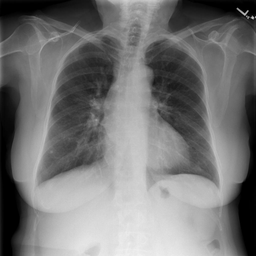

# chexbench_rad_restruct_0234
Ordinal 112; source Rad-Restruct; stopped-prefix record.

Are there any diseases in the lymph nodes?

## Complete options

- **A**: yes
- **B**: no

## Original images

Explicit answer: **B. no**; reference: **A**; correct: **False**.

Expert model confirms no lymph node disease and visual inspection shows normal hilar/mediastinal contours without adenopathy.

[Prediction](../../evidence/chexbench/predictions/M43-IM-GT-S50-CXR6/chexbench_rad_restruct_0234.json) · [own post-prediction feedback](../../evidence/chexbench/feedback/chexbench_rad_restruct_0234.json) · [exact context and Skill version](../../evidence/chexbench/contexts/chexbench_rad_restruct_0234.json) · [all main requests/responses](../../evidence/chexbench/services/calls/R50-AGENT/chexbench_rad_restruct_0234)

## Tool requests and observations

- chest_xray_expert: status=completed; [selection](../../evidence/chexbench/services/tool_selections/R50-AGENT/chexbench_rad_restruct_0234/1.json), [full request/result/stdout/stderr artifacts](../../evidence/chexbench/services/tool_cache/58ccfabb2a89227a83676ba3f7b7a3ab5cd24f52f3f9eea716878b9784385337).

## Skill and prior-image provenance

Selected IDs: []; prior same-image IDs: ['chexbench_rad_restruct_0211'].

This is dataset-label scoring and model/tool narrative, not clinical adjudication or Skill causal verification.
