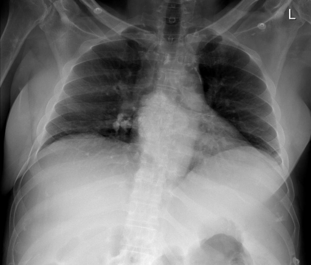

# chexbench_rad_restruct_0235
Ordinal 113; source Rad-Restruct; stopped-prefix record.

Is there anything abnormal in the lung?

## Complete options

- **A**: no
- **B**: yes

## Original images

Explicit answer: **A. no**; reference: **B**; correct: **False**.

Both expert VLMs confirm the lung fields are clear with no consolidation, mass, nodule, or effusion.

[Prediction](../../evidence/chexbench/predictions/M43-IM-GT-S50-CXR6/chexbench_rad_restruct_0235.json) · [own post-prediction feedback](../../evidence/chexbench/feedback/chexbench_rad_restruct_0235.json) · [exact context and Skill version](../../evidence/chexbench/contexts/chexbench_rad_restruct_0235.json) · [all main requests/responses](../../evidence/chexbench/services/calls/R50-AGENT/chexbench_rad_restruct_0235)

## Tool requests and observations

- medgemma: status=completed; [selection](../../evidence/chexbench/services/tool_selections/R50-AGENT/chexbench_rad_restruct_0235/1.json), [full request/result/stdout/stderr artifacts](../../evidence/chexbench/services/tool_cache/28957f8321d564621885af1c3dbdfda561ce7a4cb23b01522d72b1f4edc885ab).
- chest_xray_expert: status=completed; [selection](../../evidence/chexbench/services/tool_selections/R50-AGENT/chexbench_rad_restruct_0235/2.json), [full request/result/stdout/stderr artifacts](../../evidence/chexbench/services/tool_cache/8b3685d4c8fae6000ee93494c7204dc20c3b93869b05adfb7399d1a5ef85c35c).

## Skill and prior-image provenance

Selected IDs: []; prior same-image IDs: [].

This is dataset-label scoring and model/tool narrative, not clinical adjudication or Skill causal verification.
