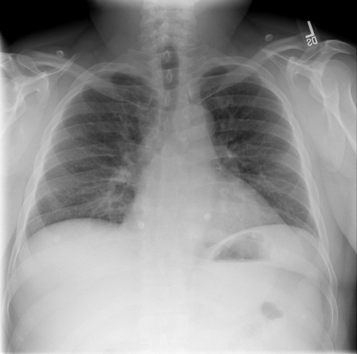

# chexbench_rad_restruct_0236
Ordinal 114; source Rad-Restruct; stopped-prefix record.

Are there any signs in the lung?

## Complete options

- **A**: no
- **B**: yes

## Original images

Explicit answer: **A. no**; reference: **B**; correct: **False**.

Both expert models confirm the lung fields appear clear with no obvious signs of pathology such as consolidation, effusion, or pneumothorax.

[Prediction](../../evidence/chexbench/predictions/M43-IM-GT-S50-CXR6/chexbench_rad_restruct_0236.json) · [own post-prediction feedback](../../evidence/chexbench/feedback/chexbench_rad_restruct_0236.json) · [exact context and Skill version](../../evidence/chexbench/contexts/chexbench_rad_restruct_0236.json) · [all main requests/responses](../../evidence/chexbench/services/calls/R50-AGENT/chexbench_rad_restruct_0236)

## Tool requests and observations

- medgemma: status=completed; [selection](../../evidence/chexbench/services/tool_selections/R50-AGENT/chexbench_rad_restruct_0236/1.json), [full request/result/stdout/stderr artifacts](../../evidence/chexbench/services/tool_cache/0a7fbeeeadf99a1967541e0fd5d18717c3692d2255d16235a9ebeed5758a24b9).
- chest_xray_expert: status=completed; [selection](../../evidence/chexbench/services/tool_selections/R50-AGENT/chexbench_rad_restruct_0236/2.json), [full request/result/stdout/stderr artifacts](../../evidence/chexbench/services/tool_cache/9c2040177e4e19a3a7397f409b832843afb97ec72de7031a5a00ef5f97c83c3c).

## Skill and prior-image provenance

Selected IDs: []; prior same-image IDs: [].

This is dataset-label scoring and model/tool narrative, not clinical adjudication or Skill causal verification.
