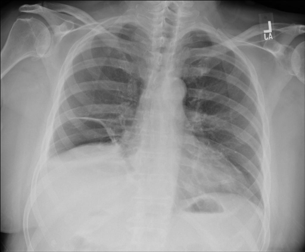

# chexbench_rad_restruct_0237
Ordinal 115; source Rad-Restruct; stopped-prefix record.

Is there anything abnormal in the skeletal system?

## Complete options

- **A**: yes
- **B**: no

## Original images

Explicit answer: **B. no**; reference: **A**; correct: **False**.

Both MedGemma and CheXagent confirm no visible fractures, lytic lesions, or skeletal abnormalities in the ribs, clavicles, scapulae, or spine.

[Prediction](../../evidence/chexbench/predictions/M43-IM-GT-S50-CXR6/chexbench_rad_restruct_0237.json) · [own post-prediction feedback](../../evidence/chexbench/feedback/chexbench_rad_restruct_0237.json) · [exact context and Skill version](../../evidence/chexbench/contexts/chexbench_rad_restruct_0237.json) · [all main requests/responses](../../evidence/chexbench/services/calls/R50-AGENT/chexbench_rad_restruct_0237)

## Tool requests and observations

- medgemma: status=completed; [selection](../../evidence/chexbench/services/tool_selections/R50-AGENT/chexbench_rad_restruct_0237/1.json), [full request/result/stdout/stderr artifacts](../../evidence/chexbench/services/tool_cache/17a876c19083e4613f4954fdd3320343f8dac179d28a92a1fa62ccd39f13ff4c).
- chest_xray_expert: status=completed; [selection](../../evidence/chexbench/services/tool_selections/R50-AGENT/chexbench_rad_restruct_0237/2.json), [full request/result/stdout/stderr artifacts](../../evidence/chexbench/services/tool_cache/d1543822f5f5e96db208f66bcbbbfb32c1078012b0e180b22e9d3a58452201de).

## Skill and prior-image provenance

Selected IDs: []; prior same-image IDs: [].

This is dataset-label scoring and model/tool narrative, not clinical adjudication or Skill causal verification.
