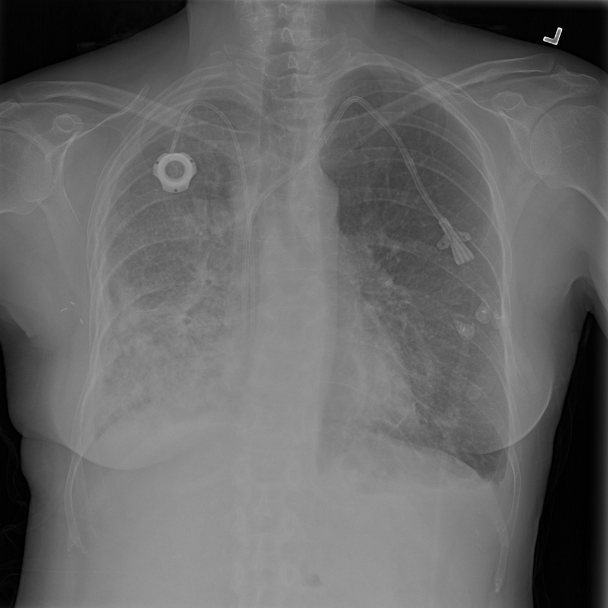

# chexbench_slake_0000
Ordinal 116; source SLAKE; stopped-prefix record.

Is this image normal?

## Complete options

- **A**: no
- **B**: yes

## Original images

Explicit answer: **A. no**; reference: **A**; correct: **True**.

The image shows bilateral lung opacities, a right-sided port-a-cath, and a left-sided central venous catheter, indicating significant abnormalities.

[Prediction](../../evidence/chexbench/predictions/M43-IM-GT-S50-CXR6/chexbench_slake_0000.json) · [own post-prediction feedback](../../evidence/chexbench/feedback/chexbench_slake_0000.json) · [exact context and Skill version](../../evidence/chexbench/contexts/chexbench_slake_0000.json) · [all main requests/responses](../../evidence/chexbench/services/calls/R50-AGENT/chexbench_slake_0000)

## Tool requests and observations

- medgemma: status=completed; [selection](../../evidence/chexbench/services/tool_selections/R50-AGENT/chexbench_slake_0000/1.json), [full request/result/stdout/stderr artifacts](../../evidence/chexbench/services/tool_cache/dd00fb85bc7c4bd350d05a0959a4762029ee5c18450bdbc6faca4fe7303d8dc9).
- chest_xray_expert: status=completed; [selection](../../evidence/chexbench/services/tool_selections/R50-AGENT/chexbench_slake_0000/2.json), [full request/result/stdout/stderr artifacts](../../evidence/chexbench/services/tool_cache/7d398a452f427dad7c1ba05a42cf96232beef51df77f03444c73bb16d61dbb44).

## Skill and prior-image provenance

Selected IDs: []; prior same-image IDs: [].

This is dataset-label scoring and model/tool narrative, not clinical adjudication or Skill causal verification.
