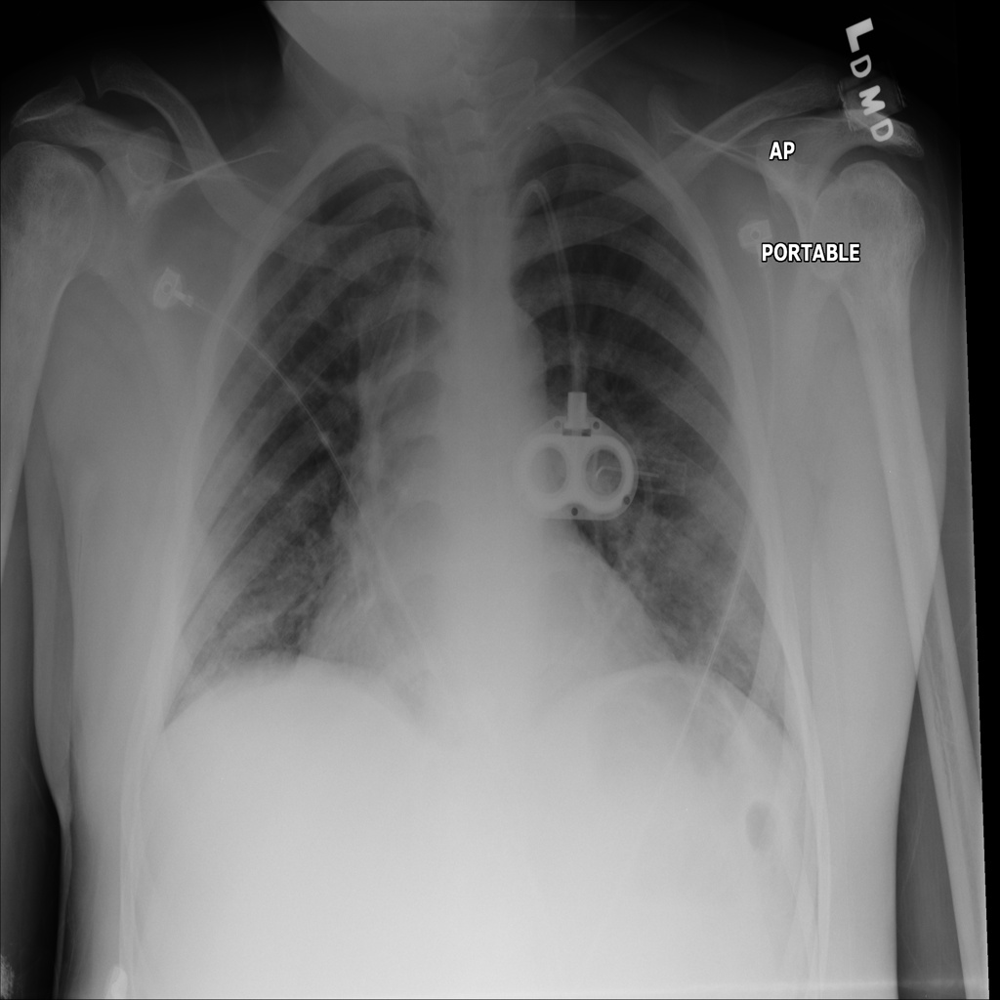
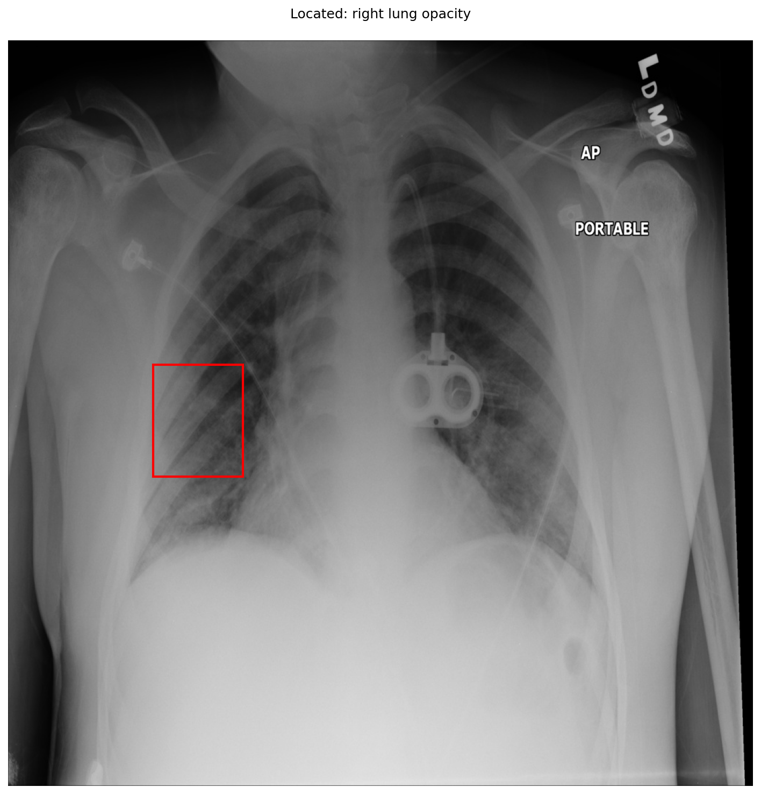

# chexbench_slake_0001
Ordinal 117; source SLAKE; stopped-prefix record.

Is/Are there abnormalities in the patient's right lung?

## Complete options

- **A**: no
- **B**: yes

## Original images

Explicit answer: **B. yes**; reference: **B**; correct: **True**.

The grounding tool successfully localized a right lung opacity, and medgemma confirmed increased opacity in the right lung field, indicating an abnormality despite conflicting negative reports from other models.

[Prediction](../../evidence/chexbench/predictions/M43-IM-GT-S50-CXR6/chexbench_slake_0001.json) · [own post-prediction feedback](../../evidence/chexbench/feedback/chexbench_slake_0001.json) · [exact context and Skill version](../../evidence/chexbench/contexts/chexbench_slake_0001.json) · [all main requests/responses](../../evidence/chexbench/services/calls/R50-AGENT/chexbench_slake_0001)

## Tool requests and observations

- medgemma: status=completed; [selection](../../evidence/chexbench/services/tool_selections/R50-AGENT/chexbench_slake_0001/1.json), [full request/result/stdout/stderr artifacts](../../evidence/chexbench/services/tool_cache/75242c93c597d6be989145d17ed95007231aa2259c39f1f500a5b9821d6f14fd).
- chest_xray_expert: status=completed; [selection](../../evidence/chexbench/services/tool_selections/R50-AGENT/chexbench_slake_0001/2.json), [full request/result/stdout/stderr artifacts](../../evidence/chexbench/services/tool_cache/0b29e1693147d28e150efe2ecd588089fa91b726076f87c2bcb5a967ca37cf34).
- llava_rad: status=completed; [selection](../../evidence/chexbench/services/tool_selections/R50-AGENT/chexbench_slake_0001/3.json), [full request/result/stdout/stderr artifacts](../../evidence/chexbench/services/tool_cache/6ae022b196fbe9e20289ba3e5469745d3bee5919f2555e3253b69a029adc3084).
- xray_phrase_grounding: status=completed; [selection](../../evidence/chexbench/services/tool_selections/R50-AGENT/chexbench_slake_0001/4.json), [full request/result/stdout/stderr artifacts](../../evidence/chexbench/services/tool_cache/8623a5e41c43d1c7b10f44db38d866abc2213694a0f4219445cf90207fda60c6).

## Skill and prior-image provenance

Selected IDs: []; prior same-image IDs: [].

This is dataset-label scoring and model/tool narrative, not clinical adjudication or Skill causal verification.
