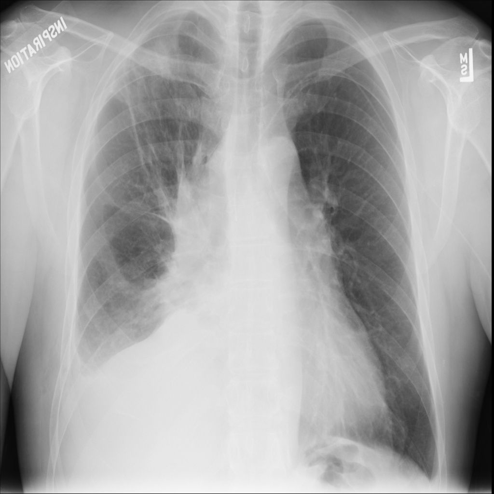

# chexbench_slake_0003
Ordinal 119; source SLAKE; stopped-prefix record.

Does the lung look abnormal?

## Complete options

- **A**: no
- **B**: yes

## Original images

Explicit answer: **B. yes**; reference: **B**; correct: **True**.

The right lung shows significant opacity and volume loss with mediastinal shift, indicating clear abnormality.

[Prediction](../../evidence/chexbench/predictions/M43-IM-GT-S50-CXR6/chexbench_slake_0003.json) · [own post-prediction feedback](../../evidence/chexbench/feedback/chexbench_slake_0003.json) · [exact context and Skill version](../../evidence/chexbench/contexts/chexbench_slake_0003.json) · [all main requests/responses](../../evidence/chexbench/services/calls/R50-AGENT/chexbench_slake_0003)

## Tool requests and observations

- medgemma: status=completed; [selection](../../evidence/chexbench/services/tool_selections/R50-AGENT/chexbench_slake_0003/1.json), [full request/result/stdout/stderr artifacts](../../evidence/chexbench/services/tool_cache/6f6a3513f978f2989b3df8e7708036ff4b07644122ad21187588a5956d6bb791).
- chest_xray_expert: status=completed; [selection](../../evidence/chexbench/services/tool_selections/R50-AGENT/chexbench_slake_0003/2.json), [full request/result/stdout/stderr artifacts](../../evidence/chexbench/services/tool_cache/4b7aa0d4081b2778ac3897a362c2206969a761ec949631d7b27de3e77e3cf9d2).

## Skill and prior-image provenance

Selected IDs: []; prior same-image IDs: [].

This is dataset-label scoring and model/tool narrative, not clinical adjudication or Skill causal verification.
