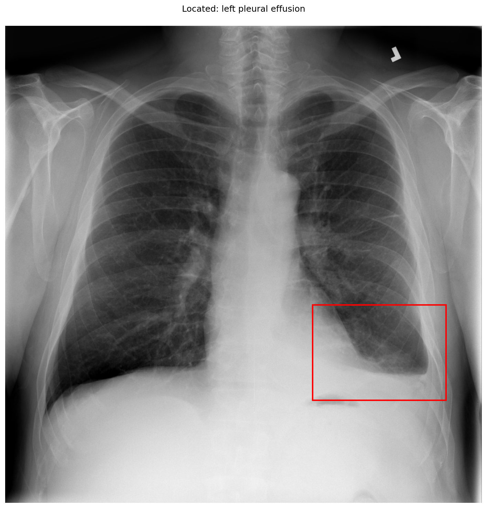

# chexbench_slake_0004
Ordinal 120; source SLAKE; stopped-prefix record.

Does the lung look abnormal?

## Complete options

- **A**: no
- **B**: yes

## Original images

Explicit answer: **B. yes**; reference: **B**; correct: **True**.

Grounded evidence confirms a left pleural effusion (opacity at left lung base), indicating the lung is abnormal.

[Prediction](../../evidence/chexbench/predictions/M43-IM-GT-S50-CXR6/chexbench_slake_0004.json) · [own post-prediction feedback](../../evidence/chexbench/feedback/chexbench_slake_0004.json) · [exact context and Skill version](../../evidence/chexbench/contexts/chexbench_slake_0004.json) · [all main requests/responses](../../evidence/chexbench/services/calls/R50-AGENT/chexbench_slake_0004)

## Tool requests and observations

- medgemma: status=completed; [selection](../../evidence/chexbench/services/tool_selections/R50-AGENT/chexbench_slake_0004/1.json), [full request/result/stdout/stderr artifacts](../../evidence/chexbench/services/tool_cache/11c174cb86901c476e5821b1b0b81d6f838e7e04b819b8133ab20dc5a25de339).
- chest_xray_expert: status=completed; [selection](../../evidence/chexbench/services/tool_selections/R50-AGENT/chexbench_slake_0004/2.json), [full request/result/stdout/stderr artifacts](../../evidence/chexbench/services/tool_cache/88479f20b680b7a701b1d9be46e0e20ce6aa5e0f6af5eafd357310b3c5e5aef2).
- xray_phrase_grounding: status=completed; [selection](../../evidence/chexbench/services/tool_selections/R50-AGENT/chexbench_slake_0004/3.json), [full request/result/stdout/stderr artifacts](../../evidence/chexbench/services/tool_cache/915f68a2ec4518bc598df3e3ae82554862a749d0e568e182234de6e57342b9b9).

## Skill and prior-image provenance

Selected IDs: []; prior same-image IDs: [].

This is dataset-label scoring and model/tool narrative, not clinical adjudication or Skill causal verification.
