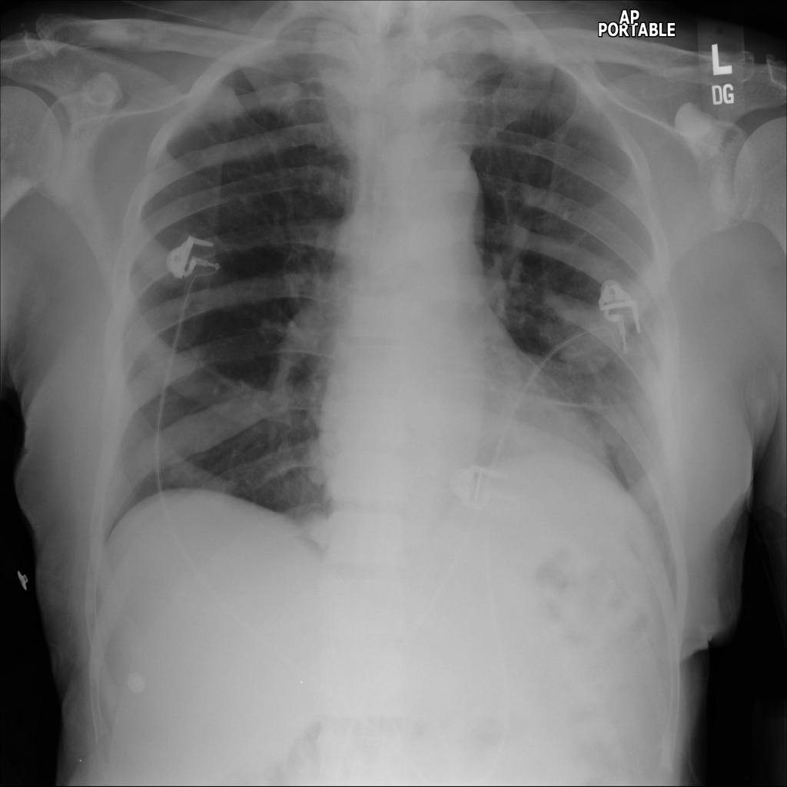
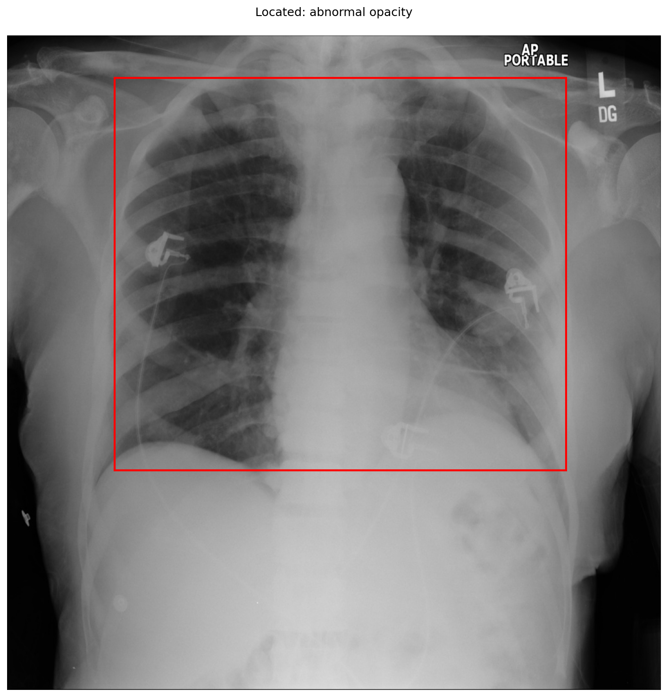

# chexbench_slake_0005
Ordinal 121; source SLAKE; stopped-prefix record.

Are there abnormalities in this image?

## Complete options

- **A**: no
- **B**: yes

## Original images

Explicit answer: **B. yes**; reference: **B**; correct: **True**.

The chest_xray_expert model identified abnormalities, and the grounding tool highlighted a broad region of potential abnormal opacity in the lung fields.

[Prediction](../../evidence/chexbench/predictions/M43-IM-GT-S50-CXR6/chexbench_slake_0005.json) · [own post-prediction feedback](../../evidence/chexbench/feedback/chexbench_slake_0005.json) · [exact context and Skill version](../../evidence/chexbench/contexts/chexbench_slake_0005.json) · [all main requests/responses](../../evidence/chexbench/services/calls/R50-AGENT/chexbench_slake_0005)

## Tool requests and observations

- medgemma: status=completed; [selection](../../evidence/chexbench/services/tool_selections/R50-AGENT/chexbench_slake_0005/1.json), [full request/result/stdout/stderr artifacts](../../evidence/chexbench/services/tool_cache/1e25cc41add4dacd0267715151dcb0d300b3ba1eaeb8e8f32af2ca5225078f71).
- chest_xray_expert: status=completed; [selection](../../evidence/chexbench/services/tool_selections/R50-AGENT/chexbench_slake_0005/2.json), [full request/result/stdout/stderr artifacts](../../evidence/chexbench/services/tool_cache/607475a28f17de4e9778dd2856723f7ed9628e8f82a6cc7f01a4704325694dce).
- xray_phrase_grounding: status=completed; [selection](../../evidence/chexbench/services/tool_selections/R50-AGENT/chexbench_slake_0005/3.json), [full request/result/stdout/stderr artifacts](../../evidence/chexbench/services/tool_cache/dcbbfd6e2fff403fef92aeeb17e19592c98acd9e7f0d0a13e2f83fa35be2cb2d).

## Skill and prior-image provenance

Selected IDs: []; prior same-image IDs: [].

This is dataset-label scoring and model/tool narrative, not clinical adjudication or Skill causal verification.
