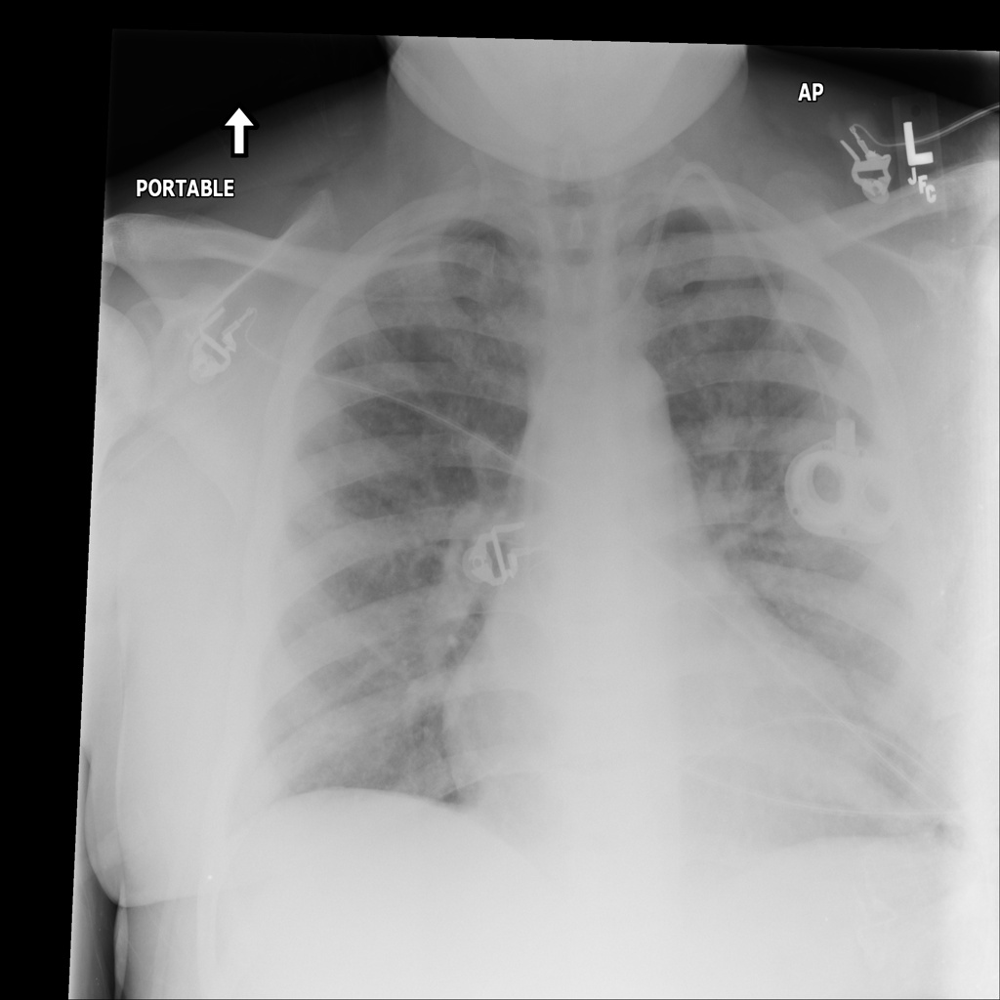

# chexbench_slake_0012
Ordinal 128; source SLAKE; stopped-prefix record.

Does this image look abnormal?

## Complete options

- **A**: yes
- **B**: no

## Original images

Explicit answer: **A. yes**; reference: **A**; correct: **True**.

Both medgemma and chest_xray_expert confirm the presence of cardiomegaly and pulmonary edema, indicating an abnormal chest X-ray.

[Prediction](../../evidence/chexbench/predictions/M43-IM-GT-S50-CXR6/chexbench_slake_0012.json) · [own post-prediction feedback](../../evidence/chexbench/feedback/chexbench_slake_0012.json) · [exact context and Skill version](../../evidence/chexbench/contexts/chexbench_slake_0012.json) · [all main requests/responses](../../evidence/chexbench/services/calls/R50-AGENT/chexbench_slake_0012)

## Tool requests and observations

- medgemma: status=completed; [selection](../../evidence/chexbench/services/tool_selections/R50-AGENT/chexbench_slake_0012/1.json), [full request/result/stdout/stderr artifacts](../../evidence/chexbench/services/tool_cache/4dcced21022f2346efdd940b31ce7111bdfe84f3cd050948a048ae2d5e95a9af).
- chest_xray_expert: status=completed; [selection](../../evidence/chexbench/services/tool_selections/R50-AGENT/chexbench_slake_0012/2.json), [full request/result/stdout/stderr artifacts](../../evidence/chexbench/services/tool_cache/1fa10923e320c4ff628668f093926aa8d2c59e78107548fe0500a74103b7682e).

## Skill and prior-image provenance

Selected IDs: []; prior same-image IDs: [].

This is dataset-label scoring and model/tool narrative, not clinical adjudication or Skill causal verification.
