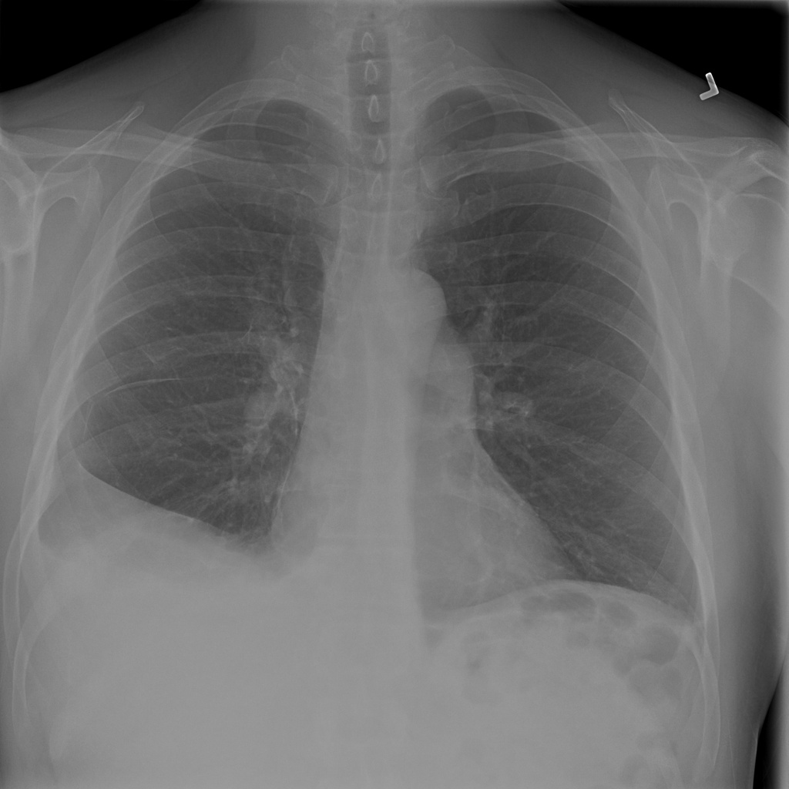
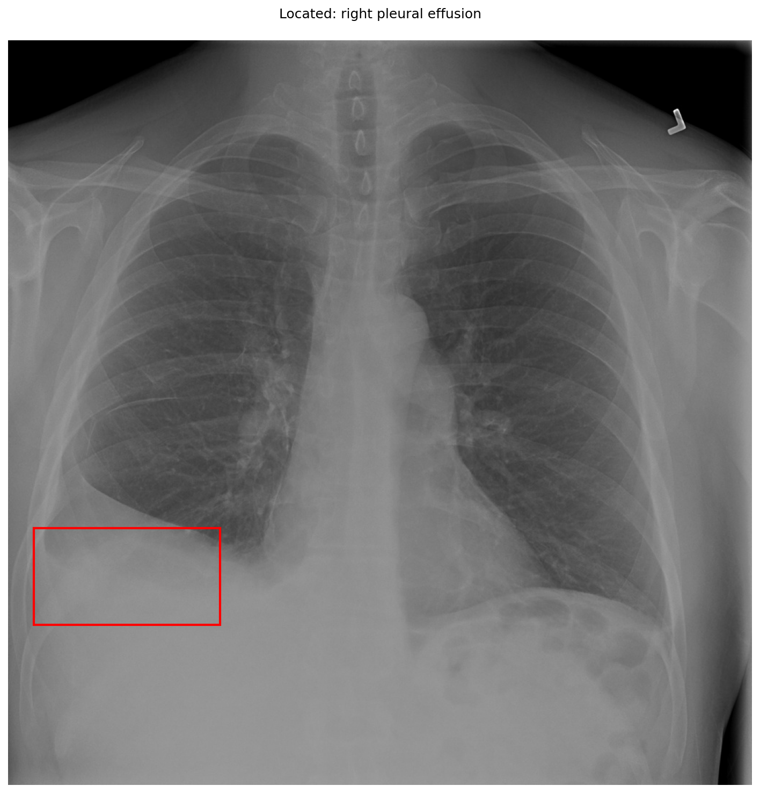

# chexbench_slake_0013
Ordinal 129; source SLAKE; stopped-prefix record.

Is the lung healthy?

## Complete options

- **A**: no
- **B**: yes

## Original images

Explicit answer: **A. no**; reference: **A**; correct: **True**.

The chest X-ray shows a right-sided pleural effusion, indicated by opacity at the right lung base and blunting of the costophrenic angle, confirming the lungs are not healthy.

[Prediction](../../evidence/chexbench/predictions/M43-IM-GT-S50-CXR6/chexbench_slake_0013.json) · [own post-prediction feedback](../../evidence/chexbench/feedback/chexbench_slake_0013.json) · [exact context and Skill version](../../evidence/chexbench/contexts/chexbench_slake_0013.json) · [all main requests/responses](../../evidence/chexbench/services/calls/R50-AGENT/chexbench_slake_0013)

## Tool requests and observations

- medgemma: status=completed; [selection](../../evidence/chexbench/services/tool_selections/R50-AGENT/chexbench_slake_0013/1.json), [full request/result/stdout/stderr artifacts](../../evidence/chexbench/services/tool_cache/5912d0a130c5a66bfa9cf261866f529001aff3f88f1e2ea2134ec576b859ae8f).
- xray_phrase_grounding: status=completed; [selection](../../evidence/chexbench/services/tool_selections/R50-AGENT/chexbench_slake_0013/2.json), [full request/result/stdout/stderr artifacts](../../evidence/chexbench/services/tool_cache/748f77fc04d70faf47b32a10fc1d9e61fcd06f7ae44ddfa8d95a442547501074).

## Skill and prior-image provenance

Selected IDs: []; prior same-image IDs: [].

This is dataset-label scoring and model/tool narrative, not clinical adjudication or Skill causal verification.
