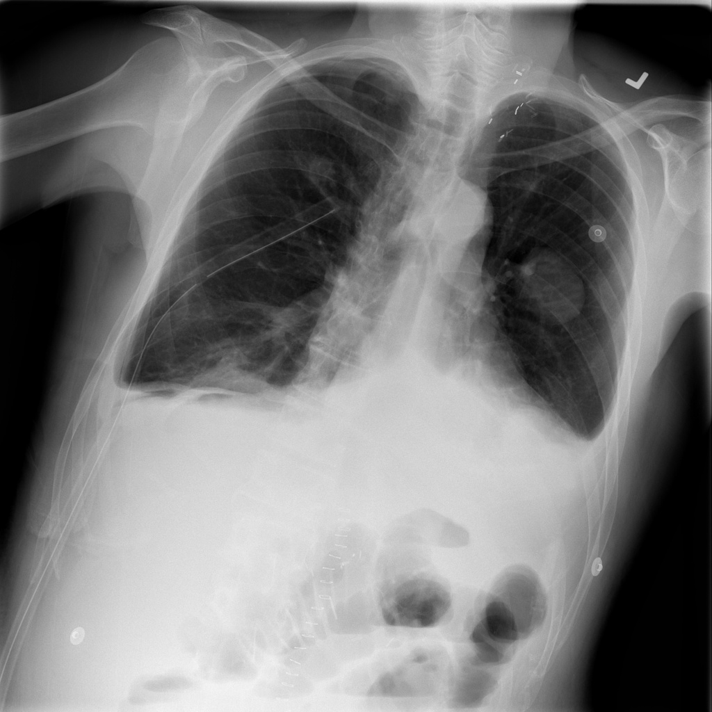
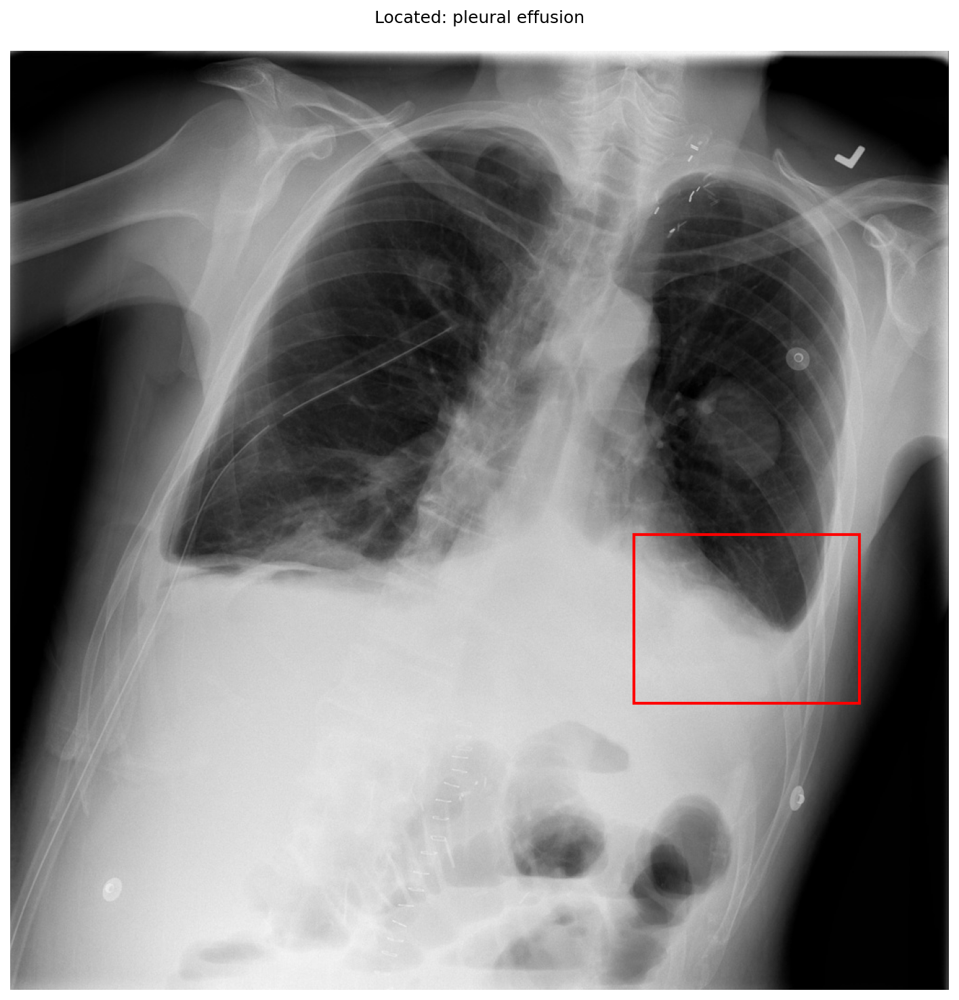

# chexbench_slake_0016
Ordinal 132; source SLAKE; stopped-prefix record.

Does the lung look abnormal?

## Complete options

- **A**: yes
- **B**: no

## Original images

Explicit answer: **A. yes**; reference: **A**; correct: **True**.

The chest X-ray shows clear evidence of abnormality, including a left-sided pleural effusion (confirmed by grounding) and right basilar opacity consistent with atelectasis or consolidation.

[Prediction](../../evidence/chexbench/predictions/M43-IM-GT-S50-CXR6/chexbench_slake_0016.json) · [own post-prediction feedback](../../evidence/chexbench/feedback/chexbench_slake_0016.json) · [exact context and Skill version](../../evidence/chexbench/contexts/chexbench_slake_0016.json) · [all main requests/responses](../../evidence/chexbench/services/calls/R50-AGENT/chexbench_slake_0016)

## Tool requests and observations

- medgemma: status=completed; [selection](../../evidence/chexbench/services/tool_selections/R50-AGENT/chexbench_slake_0016/1.json), [full request/result/stdout/stderr artifacts](../../evidence/chexbench/services/tool_cache/72a692143802f6a72900c96eb02ba19332b9672548bdeaa21694ae1f7c1280b7).
- xray_phrase_grounding: status=completed; [selection](../../evidence/chexbench/services/tool_selections/R50-AGENT/chexbench_slake_0016/2.json), [full request/result/stdout/stderr artifacts](../../evidence/chexbench/services/tool_cache/262389309dde396cf8fcc9f01bd17f3e93da230397f9cfcec9ea205222e41489).

## Skill and prior-image provenance

Selected IDs: []; prior same-image IDs: [].

This is dataset-label scoring and model/tool narrative, not clinical adjudication or Skill causal verification.
