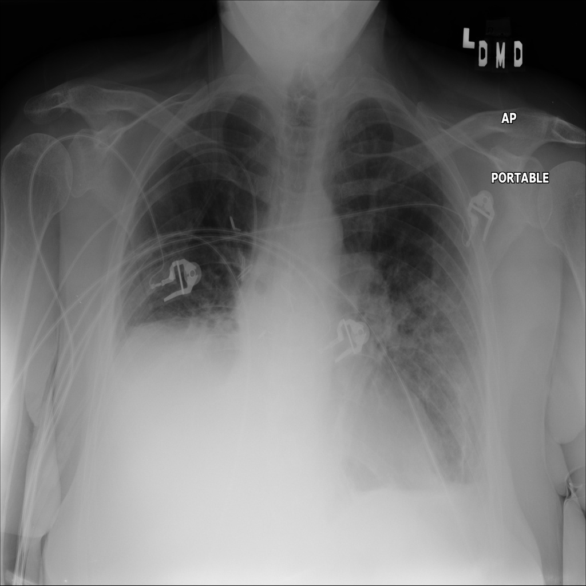

# chexbench_slake_0017
Ordinal 133; source SLAKE; stopped-prefix record.

Is the lung healthy?

## Complete options

- **A**: yes
- **B**: no

## Original images

Explicit answer: **B. no**; reference: **B**; correct: **True**.

Both models identified signs of lung pathology including consolidation, effusion, and edema.

[Prediction](../../evidence/chexbench/predictions/M43-IM-GT-S50-CXR6/chexbench_slake_0017.json) · [own post-prediction feedback](../../evidence/chexbench/feedback/chexbench_slake_0017.json) · [exact context and Skill version](../../evidence/chexbench/contexts/chexbench_slake_0017.json) · [all main requests/responses](../../evidence/chexbench/services/calls/R50-AGENT/chexbench_slake_0017)

## Tool requests and observations

- medgemma: status=completed; [selection](../../evidence/chexbench/services/tool_selections/R50-AGENT/chexbench_slake_0017/1.json), [full request/result/stdout/stderr artifacts](../../evidence/chexbench/services/tool_cache/269440e86a5b1ea88d6c427eeda9b055db274e8b6f5bc7a0c93b5b4ea23c4052).
- chest_xray_expert: status=completed; [selection](../../evidence/chexbench/services/tool_selections/R50-AGENT/chexbench_slake_0017/2.json), [full request/result/stdout/stderr artifacts](../../evidence/chexbench/services/tool_cache/33de4fbb65cab794985960deb9d3d10d1216077fb920fdf0693be488cc40eece).

## Skill and prior-image provenance

Selected IDs: []; prior same-image IDs: [].

This is dataset-label scoring and model/tool narrative, not clinical adjudication or Skill causal verification.
