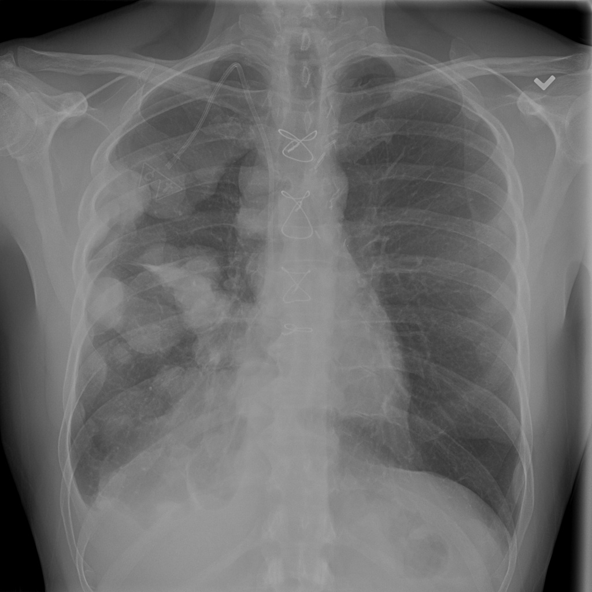
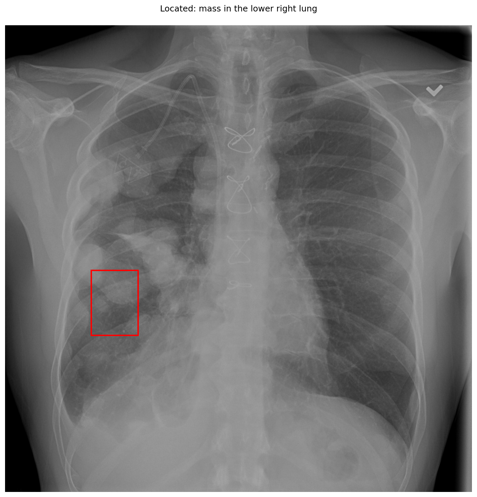

# chexbench_slake_0021
Ordinal 137; source SLAKE; stopped-prefix record.

Can mass be observed on the lower right lung in this picture?

## Complete options

- **A**: yes
- **B**: no

## Original images

Explicit answer: **A. yes**; reference: **A**; correct: **True**.

The grounding tool localized a mass in the lower right lung field, and visual inspection confirms multiple rounded opacities consistent with masses in that region.

[Prediction](../../evidence/chexbench/predictions/M43-IM-GT-S50-CXR6/chexbench_slake_0021.json) · [own post-prediction feedback](../../evidence/chexbench/feedback/chexbench_slake_0021.json) · [exact context and Skill version](../../evidence/chexbench/contexts/chexbench_slake_0021.json) · [all main requests/responses](../../evidence/chexbench/services/calls/R50-AGENT/chexbench_slake_0021)

## Tool requests and observations

- xray_phrase_grounding: status=completed; [selection](../../evidence/chexbench/services/tool_selections/R50-AGENT/chexbench_slake_0021/1.json), [full request/result/stdout/stderr artifacts](../../evidence/chexbench/services/tool_cache/c8f04a250d713ff54d4b10892643afa861e02ce88cb1dfd41887316d446c7fe5).

## Skill and prior-image provenance

Selected IDs: []; prior same-image IDs: [].

This is dataset-label scoring and model/tool narrative, not clinical adjudication or Skill causal verification.
