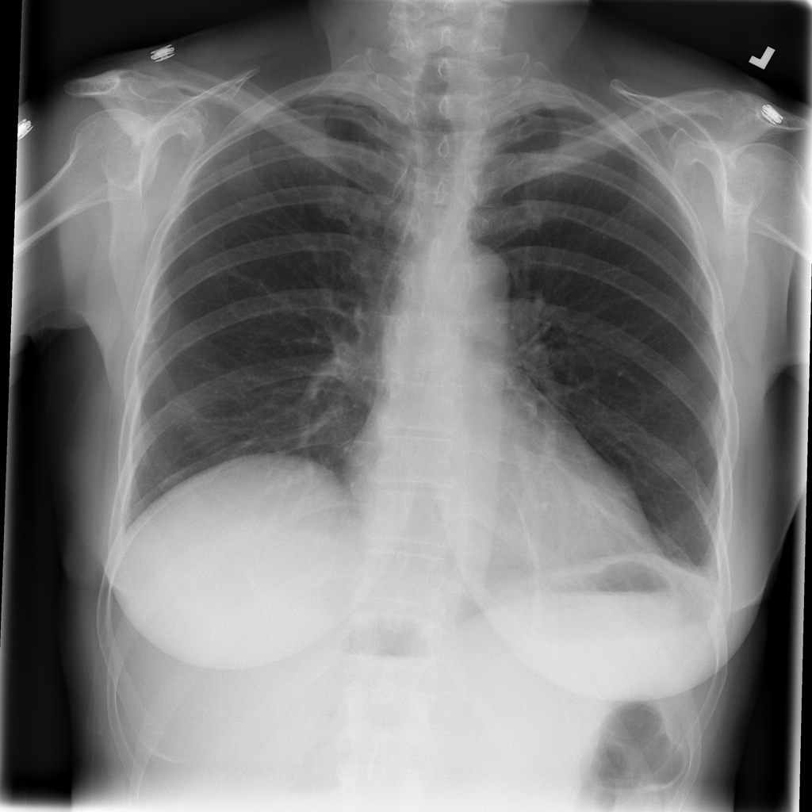

# chexbench_slake_0022
Ordinal 138; source SLAKE; stopped-prefix record.

Are there abnormalities in this image?

## Complete options

- **A**: yes
- **B**: no

## Original images

Explicit answer: **B. no**; reference: **A**; correct: **False**.

Both medgemma and chest_xray_expert independently assessed the image as normal with no obvious abnormalities such as consolidation, effusion, or masses.

[Prediction](../../evidence/chexbench/predictions/M43-IM-GT-S50-CXR6/chexbench_slake_0022.json) · [own post-prediction feedback](../../evidence/chexbench/feedback/chexbench_slake_0022.json) · [exact context and Skill version](../../evidence/chexbench/contexts/chexbench_slake_0022.json) · [all main requests/responses](../../evidence/chexbench/services/calls/R50-AGENT/chexbench_slake_0022)

## Tool requests and observations

- medgemma: status=completed; [selection](../../evidence/chexbench/services/tool_selections/R50-AGENT/chexbench_slake_0022/1.json), [full request/result/stdout/stderr artifacts](../../evidence/chexbench/services/tool_cache/a949847c61ab8c8e389b2acaab5eedea70b0e90bfe0b689a653eff7e13553107).
- chest_xray_expert: status=completed; [selection](../../evidence/chexbench/services/tool_selections/R50-AGENT/chexbench_slake_0022/2.json), [full request/result/stdout/stderr artifacts](../../evidence/chexbench/services/tool_cache/52222c98228d49309499d7f9d0b4b47dcaff29ff64f34e42b431a16e8a430d60).

## Skill and prior-image provenance

Selected IDs: []; prior same-image IDs: [].

This is dataset-label scoring and model/tool narrative, not clinical adjudication or Skill causal verification.
