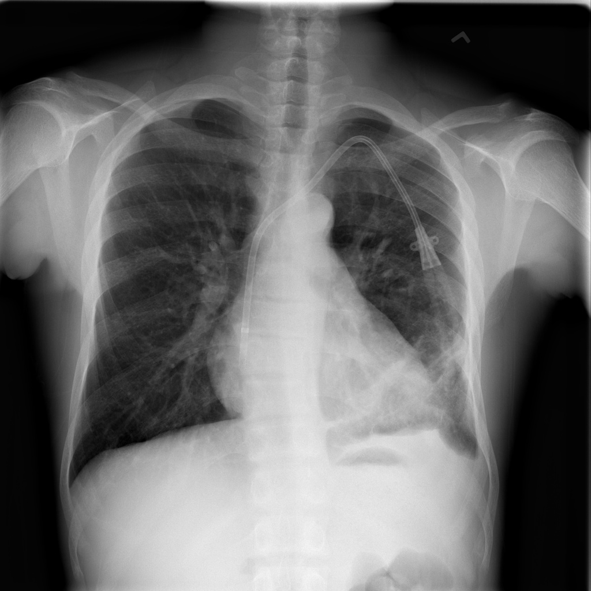
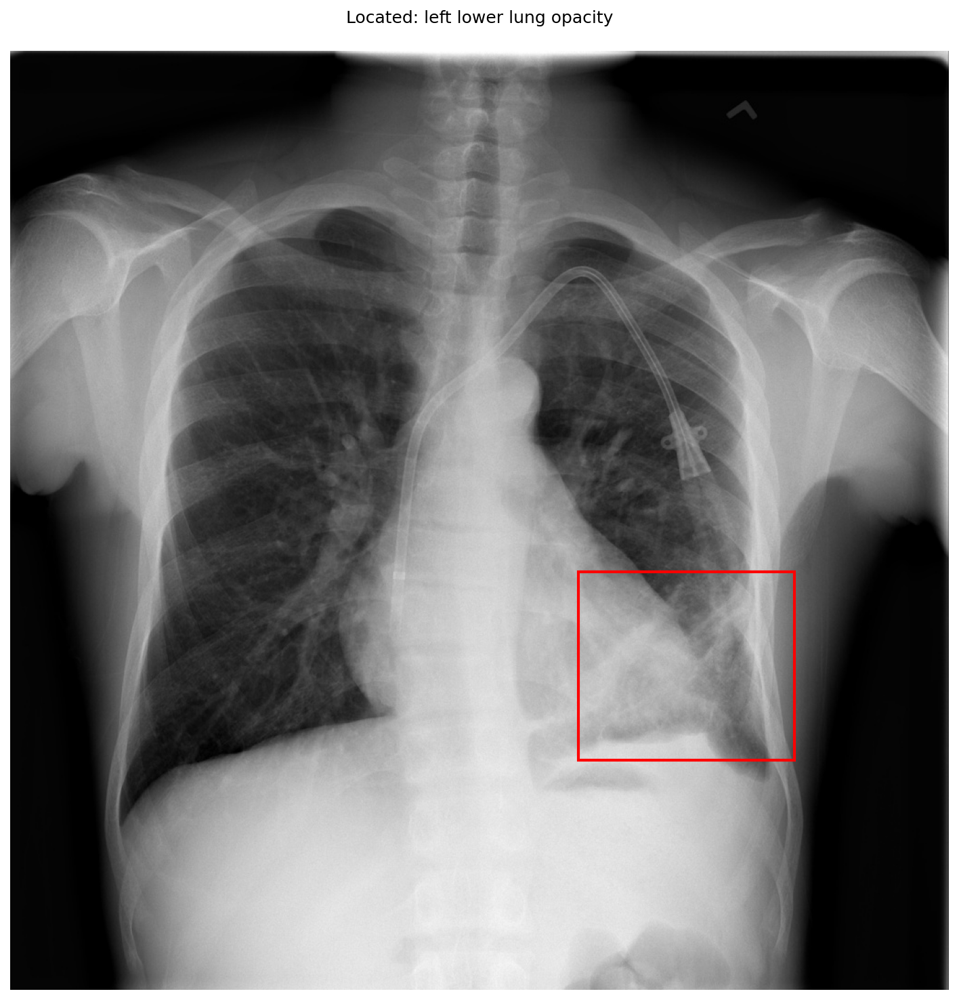

# chexbench_slake_0026
Ordinal 142; source SLAKE; stopped-prefix record.

Is the lung normal appearing?

## Complete options

- **A**: no
- **B**: yes

## Original images

Explicit answer: **A. no**; reference: **A**; correct: **True**.

The chest X-ray shows a distinct opacity in the left lower lung field, indicating an abnormality such as consolidation or effusion.

[Prediction](../../evidence/chexbench/predictions/M43-IM-GT-S50-CXR6/chexbench_slake_0026.json) · [own post-prediction feedback](../../evidence/chexbench/feedback/chexbench_slake_0026.json) · [exact context and Skill version](../../evidence/chexbench/contexts/chexbench_slake_0026.json) · [all main requests/responses](../../evidence/chexbench/services/calls/R50-AGENT/chexbench_slake_0026)

## Tool requests and observations

- medgemma: status=completed; [selection](../../evidence/chexbench/services/tool_selections/R50-AGENT/chexbench_slake_0026/1.json), [full request/result/stdout/stderr artifacts](../../evidence/chexbench/services/tool_cache/7f28598c3ff5d5f630e981c879b82d5bf8c7ff8b9cc68ac30ee17d0b34b1910a).
- xray_phrase_grounding: status=completed; [selection](../../evidence/chexbench/services/tool_selections/R50-AGENT/chexbench_slake_0026/2.json), [full request/result/stdout/stderr artifacts](../../evidence/chexbench/services/tool_cache/bb0518f5eb5c911256e1f964f70c1e037edf9544f1e0020c6895d99b13db46c4).

## Skill and prior-image provenance

Selected IDs: []; prior same-image IDs: [].

This is dataset-label scoring and model/tool narrative, not clinical adjudication or Skill causal verification.
