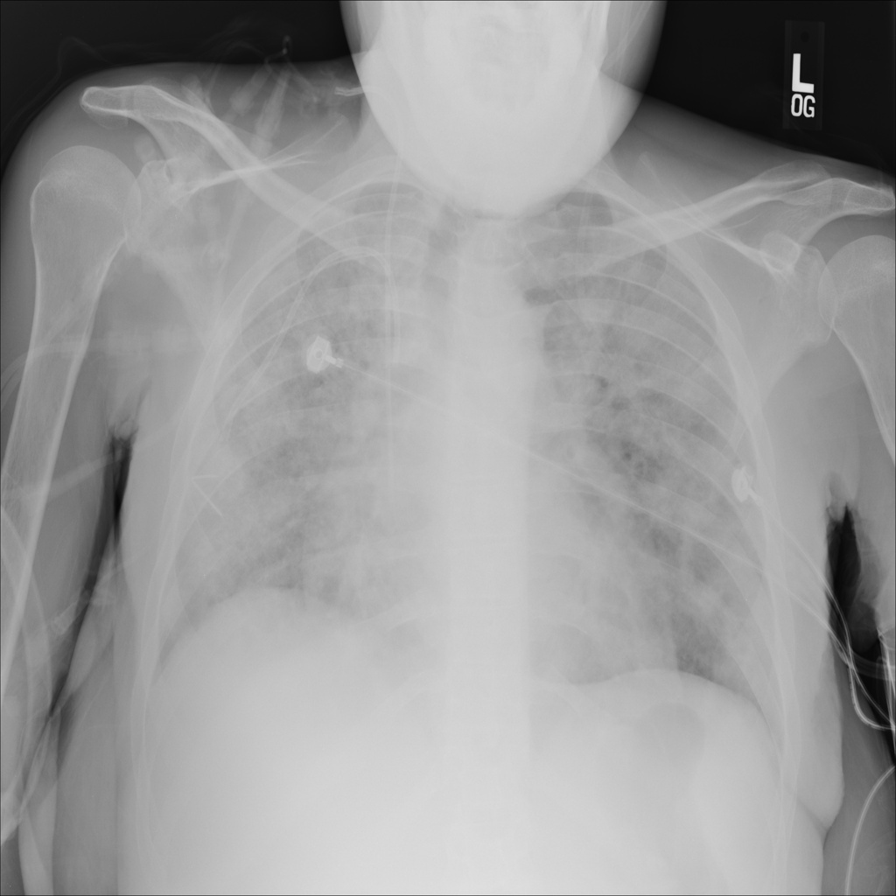

# chexbench_slake_0036
Ordinal 152; source SLAKE; stopped-prefix record.

Can pneumonia be observed on the lower left lung in this picture?

## Complete options

- **A**: no
- **B**: yes

## Original images

Explicit answer: **B. yes**; reference: **B**; correct: **True**.

Multiple models identify severe widespread pulmonary consolidation and increased opacity in the lower left lung field consistent with pneumonia.

[Prediction](../../evidence/chexbench/predictions/M43-IM-GT-S50-CXR6/chexbench_slake_0036.json) · [own post-prediction feedback](../../evidence/chexbench/feedback/chexbench_slake_0036.json) · [exact context and Skill version](../../evidence/chexbench/contexts/chexbench_slake_0036.json) · [all main requests/responses](../../evidence/chexbench/services/calls/R50-AGENT/chexbench_slake_0036)

## Tool requests and observations

- medgemma: status=completed; [selection](../../evidence/chexbench/services/tool_selections/R50-AGENT/chexbench_slake_0036/1.json), [full request/result/stdout/stderr artifacts](../../evidence/chexbench/services/tool_cache/86e20bacff7fe5fb80ccc2d0d2c7e5631d771bec973b01e79d87f49fe6b8cd6e).
- chest_xray_expert: status=completed; [selection](../../evidence/chexbench/services/tool_selections/R50-AGENT/chexbench_slake_0036/2.json), [full request/result/stdout/stderr artifacts](../../evidence/chexbench/services/tool_cache/4554662bd8f13d1ad69ff45b2d65b175bd73348be93757039ddd90891d09fd20).
- xray_phrase_grounding: status=completed; [selection](../../evidence/chexbench/services/tool_selections/R50-AGENT/chexbench_slake_0036/3.json), [full request/result/stdout/stderr artifacts](../../evidence/chexbench/services/tool_cache/b440516cc470d23da89145a9b2931307c392f3c685391458d6df96c56ea1299a).
- llava_rad: status=completed; [selection](../../evidence/chexbench/services/tool_selections/R50-AGENT/chexbench_slake_0036/4.json), [full request/result/stdout/stderr artifacts](../../evidence/chexbench/services/tool_cache/19ffad664f73324132bd29941b0a5ce64cc4a780277be174a10ce1bce3b0fb2c).
- medvlm_r1: status=completed; [selection](../../evidence/chexbench/services/tool_selections/R50-AGENT/chexbench_slake_0036/5.json), [full request/result/stdout/stderr artifacts](../../evidence/chexbench/services/tool_cache/12c1bd7253811caf53ad8670b9c279d2f45b789251cfbf66c6e1d82d0a6b3541).

## Skill and prior-image provenance

Selected IDs: []; prior same-image IDs: [].

This is dataset-label scoring and model/tool narrative, not clinical adjudication or Skill causal verification.
