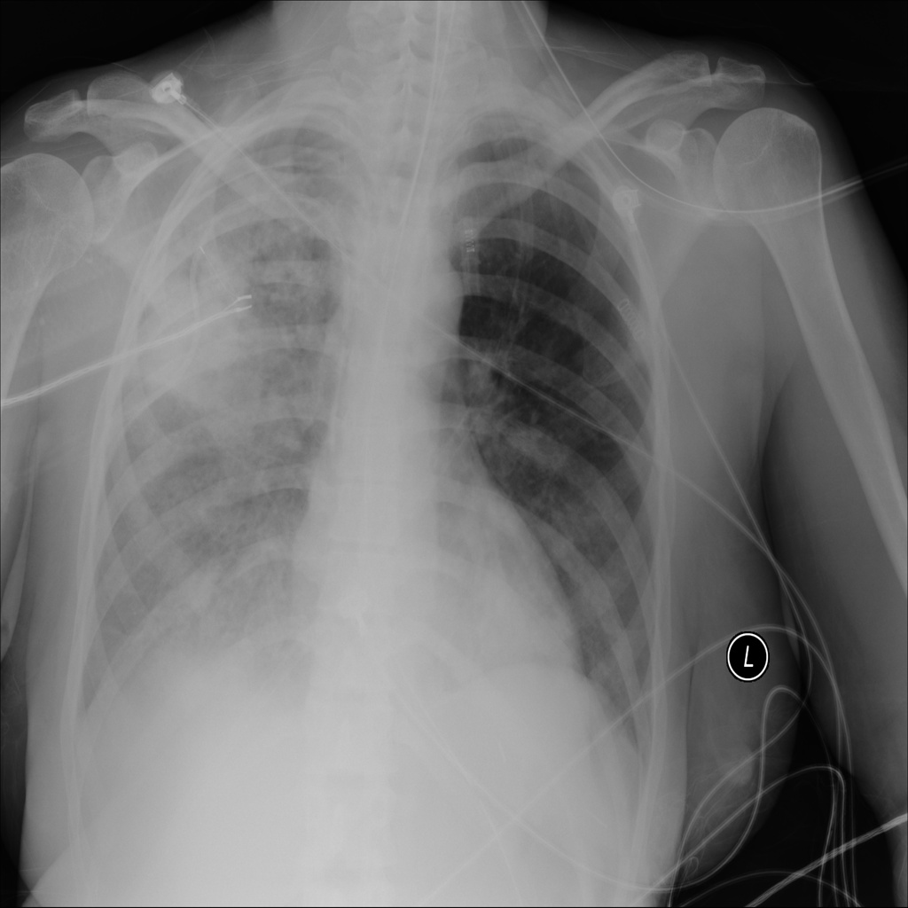
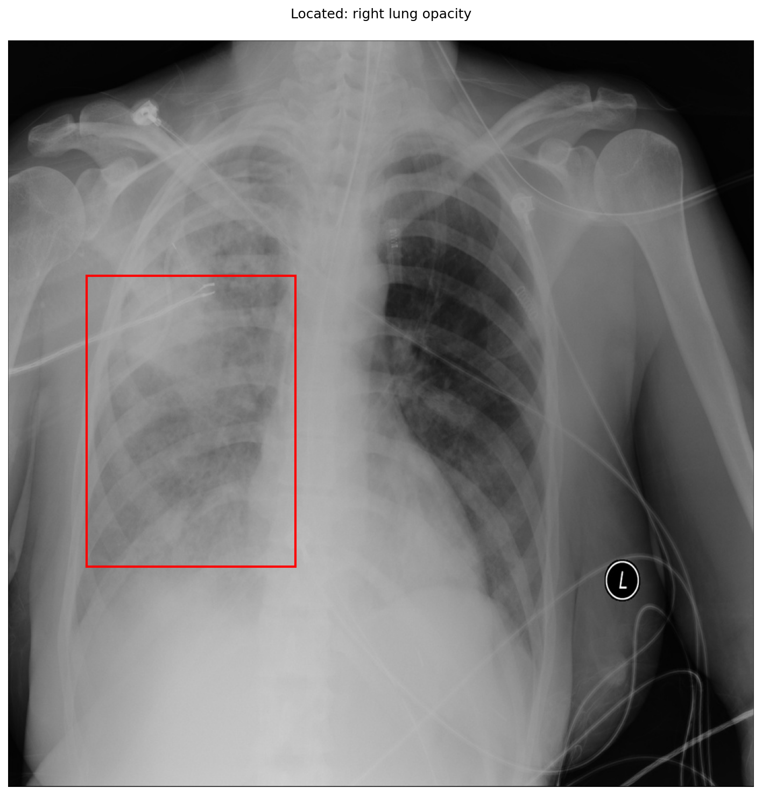

# chexbench_slake_0038
Ordinal 154; source SLAKE; stopped-prefix record.

Does the patient have any abnormalities?

## Complete options

- **A**: no
- **B**: yes

## Original images

Explicit answer: **B. yes**; reference: **B**; correct: **True**.

The chest X-ray shows significant right lung opacity and diffuse haziness, confirming the presence of abnormalities.

[Prediction](../../evidence/chexbench/predictions/M43-IM-GT-S50-CXR6/chexbench_slake_0038.json) · [own post-prediction feedback](../../evidence/chexbench/feedback/chexbench_slake_0038.json) · [exact context and Skill version](../../evidence/chexbench/contexts/chexbench_slake_0038.json) · [all main requests/responses](../../evidence/chexbench/services/calls/R50-AGENT/chexbench_slake_0038)

## Tool requests and observations

- medgemma: status=completed; [selection](../../evidence/chexbench/services/tool_selections/R50-AGENT/chexbench_slake_0038/1.json), [full request/result/stdout/stderr artifacts](../../evidence/chexbench/services/tool_cache/9d58ee5b164f4906b326077790c336313fed2878ffcd4764930b64d9c81b8b12).
- xray_phrase_grounding: status=completed; [selection](../../evidence/chexbench/services/tool_selections/R50-AGENT/chexbench_slake_0038/2.json), [full request/result/stdout/stderr artifacts](../../evidence/chexbench/services/tool_cache/ae2a4ca83f82c9322a632a5245ca47b25926ae0c1615400a1e51b860ab63272a).

## Skill and prior-image provenance

Selected IDs: []; prior same-image IDs: [].

This is dataset-label scoring and model/tool narrative, not clinical adjudication or Skill causal verification.
