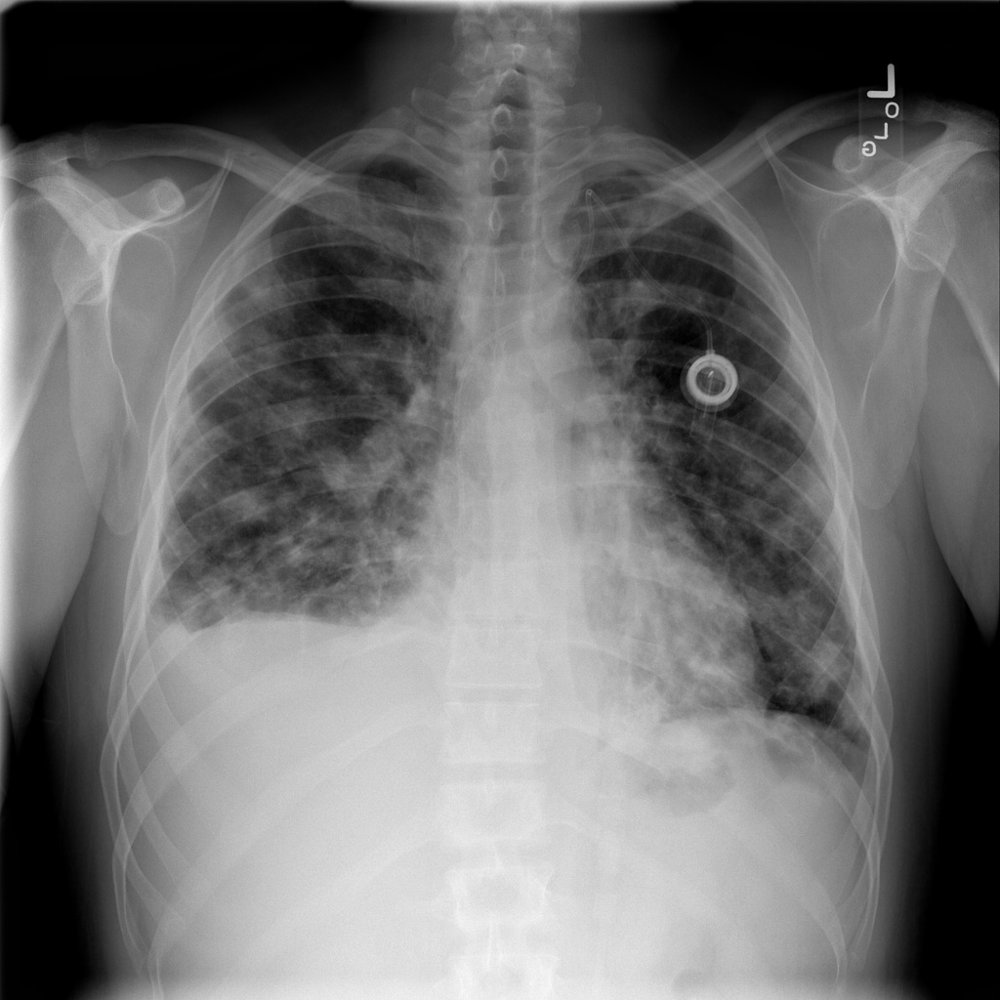

# chexbench_slake_0039
Ordinal 155; source SLAKE; stopped-prefix record.

Is the lung healthy?

## Complete options

- **A**: yes
- **B**: no

## Original images

Explicit answer: **B. no**; reference: **B**; correct: **True**.

Both models confirm diffuse lung opacities, consolidation, and possible pleural effusion, indicating unhealthy lungs.

[Prediction](../../evidence/chexbench/predictions/M43-IM-GT-S50-CXR6/chexbench_slake_0039.json) · [own post-prediction feedback](../../evidence/chexbench/feedback/chexbench_slake_0039.json) · [exact context and Skill version](../../evidence/chexbench/contexts/chexbench_slake_0039.json) · [all main requests/responses](../../evidence/chexbench/services/calls/R50-AGENT/chexbench_slake_0039)

## Tool requests and observations

- medgemma: status=completed; [selection](../../evidence/chexbench/services/tool_selections/R50-AGENT/chexbench_slake_0039/1.json), [full request/result/stdout/stderr artifacts](../../evidence/chexbench/services/tool_cache/e7ea155c53c04934e9f1ddb12f96c6149d145e9f8208dcfddea2d2cb9d07d6bd).
- chest_xray_expert: status=completed; [selection](../../evidence/chexbench/services/tool_selections/R50-AGENT/chexbench_slake_0039/2.json), [full request/result/stdout/stderr artifacts](../../evidence/chexbench/services/tool_cache/36d169536ef45c3b5d1a9be440997124a3b9463f2c024630fda09b7abe39c9cf).

## Skill and prior-image provenance

Selected IDs: []; prior same-image IDs: [].

This is dataset-label scoring and model/tool narrative, not clinical adjudication or Skill causal verification.
