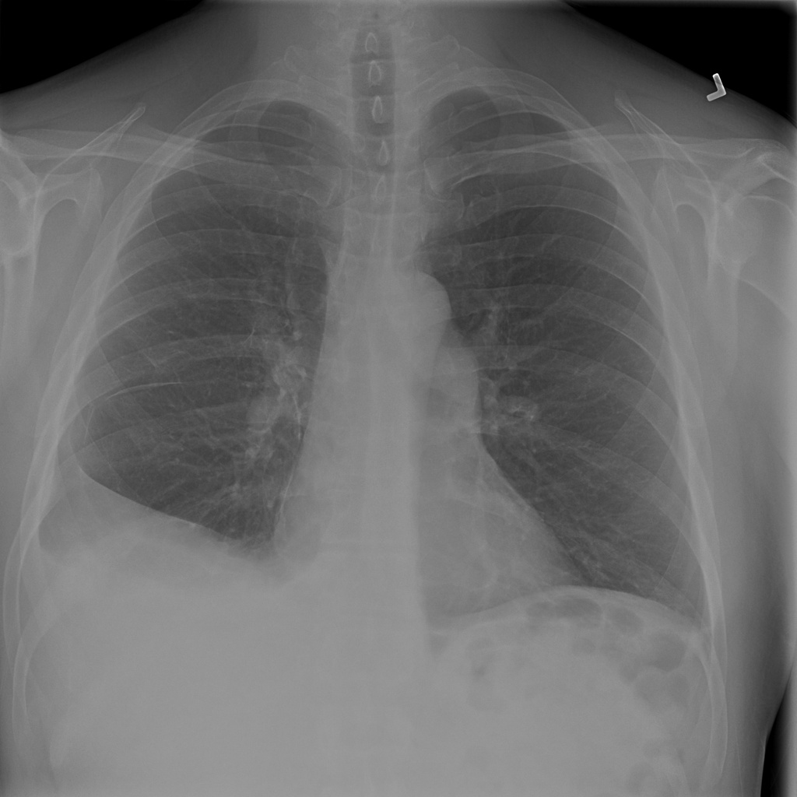

# chexbench_slake_0040
Ordinal 156; source SLAKE; stopped-prefix record.

Can pleural effusion be observed on the upper right chest in this picture?

## Complete options

- **A**: no
- **B**: yes

## Original images

Explicit answer: **A. no**; reference: **A**; correct: **True**.

Pleural effusion is observed at the right lung base, not the upper right chest.

[Prediction](../../evidence/chexbench/predictions/M43-IM-GT-S50-CXR6/chexbench_slake_0040.json) · [own post-prediction feedback](../../evidence/chexbench/feedback/chexbench_slake_0040.json) · [exact context and Skill version](../../evidence/chexbench/contexts/chexbench_slake_0040.json) · [all main requests/responses](../../evidence/chexbench/services/calls/R50-AGENT/chexbench_slake_0040)

## Tool requests and observations

## Skill and prior-image provenance

Selected IDs: []; prior same-image IDs: ['chexbench_slake_0013'].

This is dataset-label scoring and model/tool narrative, not clinical adjudication or Skill causal verification.
