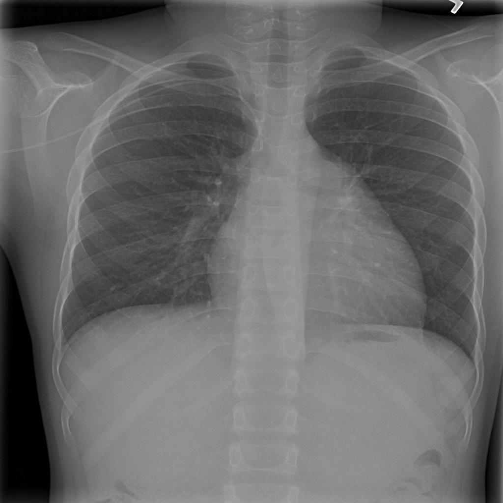
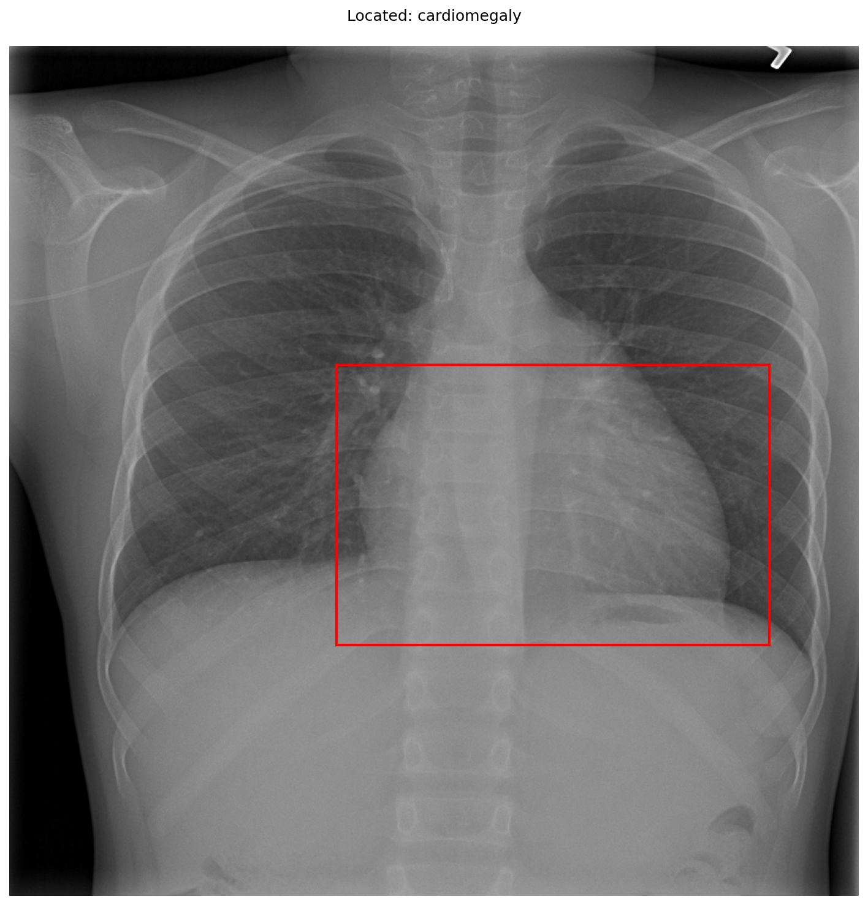

# chexbench_slake_0043
Ordinal 159; source SLAKE; stopped-prefix record.

Does this image look abnormal?

## Complete options

- **A**: no
- **B**: yes

## Original images

Explicit answer: **B. yes**; reference: **B**; correct: **True**.

The chest X-ray shows an enlarged cardiac silhouette consistent with cardiomegaly, which is an abnormal finding.

[Prediction](../../evidence/chexbench/predictions/M43-IM-GT-S50-CXR6/chexbench_slake_0043.json) · [own post-prediction feedback](../../evidence/chexbench/feedback/chexbench_slake_0043.json) · [exact context and Skill version](../../evidence/chexbench/contexts/chexbench_slake_0043.json) · [all main requests/responses](../../evidence/chexbench/services/calls/R50-AGENT/chexbench_slake_0043)

## Tool requests and observations

- medgemma: status=completed; [selection](../../evidence/chexbench/services/tool_selections/R50-AGENT/chexbench_slake_0043/1.json), [full request/result/stdout/stderr artifacts](../../evidence/chexbench/services/tool_cache/efbfef9ba5beb47adb18381b032ab137e576b05d0d637b353fc31222f5d7d15d).
- chest_xray_expert: status=completed; [selection](../../evidence/chexbench/services/tool_selections/R50-AGENT/chexbench_slake_0043/2.json), [full request/result/stdout/stderr artifacts](../../evidence/chexbench/services/tool_cache/b9eff3ff054a709eaf779b6b635173e7f67d0cf5bbf12b803da3c5551fcfb0e8).
- xray_phrase_grounding: status=completed; [selection](../../evidence/chexbench/services/tool_selections/R50-AGENT/chexbench_slake_0043/3.json), [full request/result/stdout/stderr artifacts](../../evidence/chexbench/services/tool_cache/7ed4300e00edf4fc58b7771cdfc5701200370b7283d6e90b74acefa1d723d0b7).

## Skill and prior-image provenance

Selected IDs: []; prior same-image IDs: [].

This is dataset-label scoring and model/tool narrative, not clinical adjudication or Skill causal verification.
