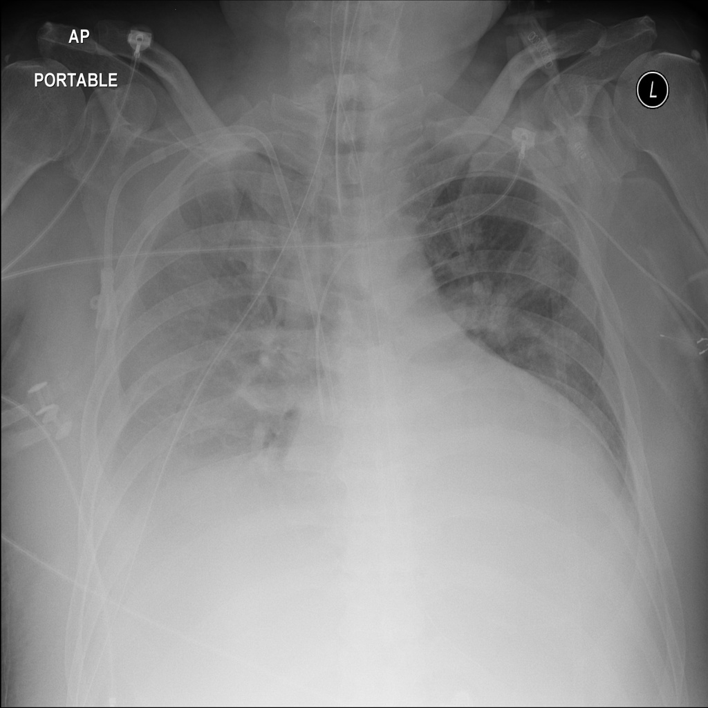

# chexbench_slake_0056
Ordinal 172; source SLAKE; stopped-prefix record.

Does this image look abnormal?

## Complete options

- **A**: no
- **B**: yes

## Original images

Explicit answer: **B. yes**; reference: **B**; correct: **True**.

The image shows significant abnormalities including right pleural effusion, left lower lobe opacity, and cardiomegaly.

[Prediction](../../evidence/chexbench/predictions/M43-IM-GT-S50-CXR6/chexbench_slake_0056.json) · [own post-prediction feedback](../../evidence/chexbench/feedback/chexbench_slake_0056.json) · [exact context and Skill version](../../evidence/chexbench/contexts/chexbench_slake_0056.json) · [all main requests/responses](../../evidence/chexbench/services/calls/R50-AGENT/chexbench_slake_0056)

## Tool requests and observations

- medgemma: status=completed; [selection](../../evidence/chexbench/services/tool_selections/R50-AGENT/chexbench_slake_0056/1.json), [full request/result/stdout/stderr artifacts](../../evidence/chexbench/services/tool_cache/3d724ab198bbd642bdf6d6042fc8b9a5af2c882eccb095687a90dc8f7d8faae6).
- chest_xray_expert: status=completed; [selection](../../evidence/chexbench/services/tool_selections/R50-AGENT/chexbench_slake_0056/2.json), [full request/result/stdout/stderr artifacts](../../evidence/chexbench/services/tool_cache/49a882fe3b861cf1a86bafe5b1ed33ba724816445a2f61b3c1697a5ce10f2815).

## Skill and prior-image provenance

Selected IDs: []; prior same-image IDs: [].

This is dataset-label scoring and model/tool narrative, not clinical adjudication or Skill causal verification.
