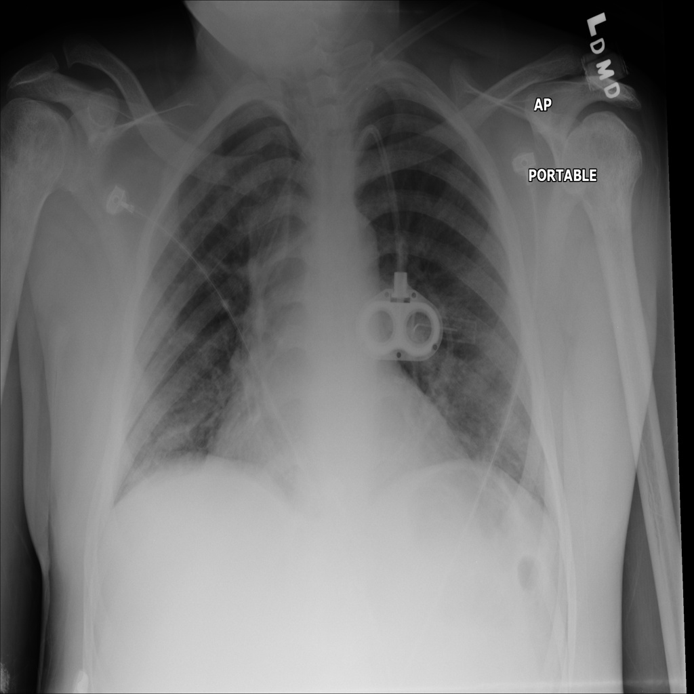
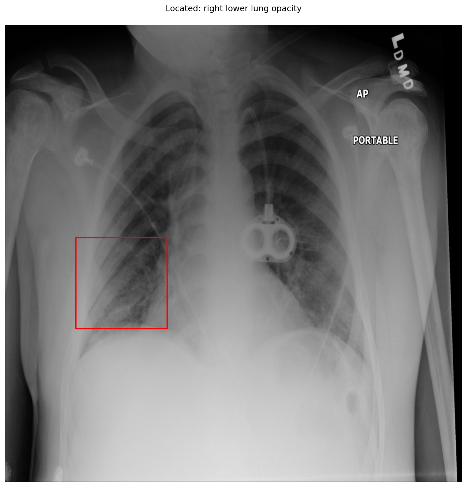

# chexbench_slake_0060
Ordinal 176; source SLAKE; stopped-prefix record.

Can pneumonia be observed on the lower right lung in this picture?

## Complete options

- **A**: no
- **B**: yes

## Original images

Explicit answer: **B. yes**; reference: **B**; correct: **True**.

Grounding tool localized a right lower lung opacity consistent with pneumonia, and prior evidence confirmed right lung abnormality.

[Prediction](../../evidence/chexbench/predictions/M43-IM-GT-S50-CXR6/chexbench_slake_0060.json) · [own post-prediction feedback](../../evidence/chexbench/feedback/chexbench_slake_0060.json) · [exact context and Skill version](../../evidence/chexbench/contexts/chexbench_slake_0060.json) · [all main requests/responses](../../evidence/chexbench/services/calls/R50-AGENT/chexbench_slake_0060)

## Tool requests and observations

- xray_phrase_grounding: status=completed; [selection](../../evidence/chexbench/services/tool_selections/R50-AGENT/chexbench_slake_0060/1.json), [full request/result/stdout/stderr artifacts](../../evidence/chexbench/services/tool_cache/9ec0816404a19d87027aa6bbeb900c2447337199c96d2ff8e4452975aae53a0e).

## Skill and prior-image provenance

Selected IDs: []; prior same-image IDs: ['chexbench_slake_0001', 'chexbench_slake_0008'].

This is dataset-label scoring and model/tool narrative, not clinical adjudication or Skill causal verification.
