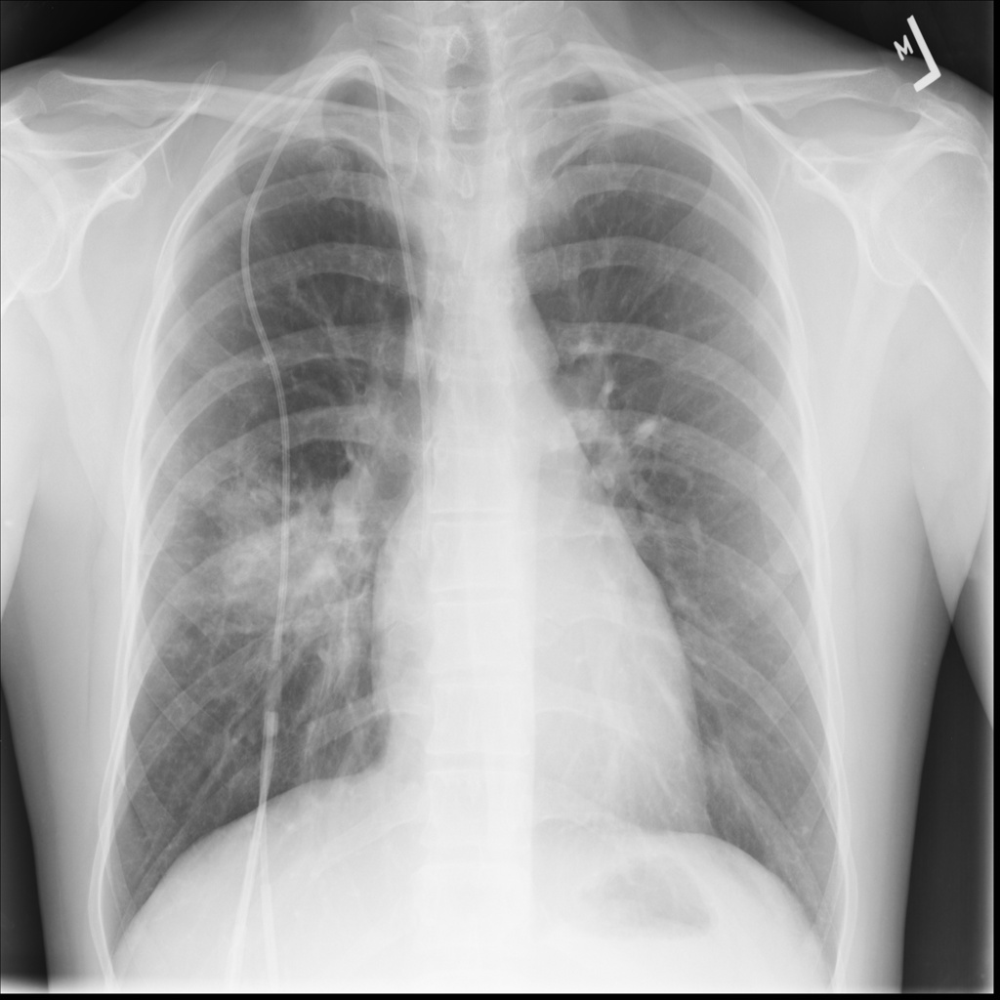
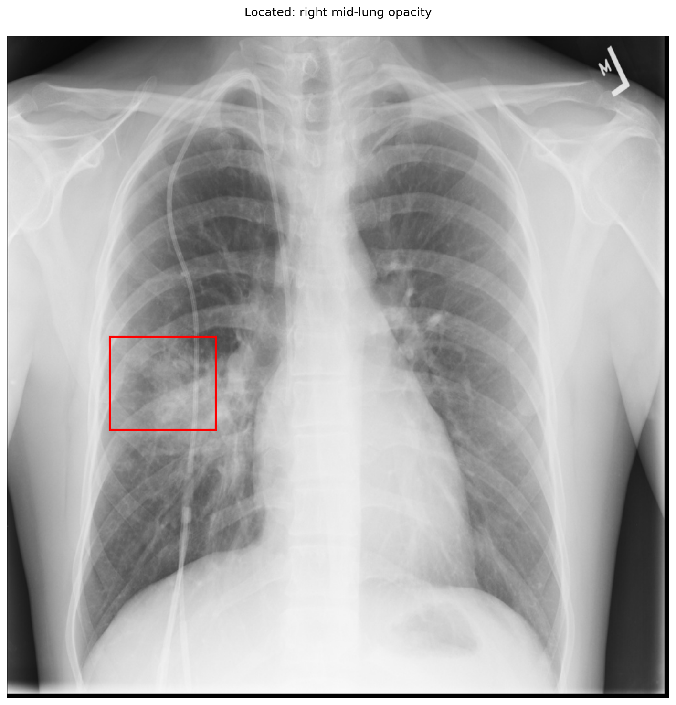

# chexbench_slake_0062
Ordinal 178; source SLAKE; stopped-prefix record.

Is/Are there abnormalities in the patient's right lung?

## Complete options

- **A**: yes
- **B**: no

## Original images

Explicit answer: **A. yes**; reference: **A**; correct: **True**.

Grounding confirms a visible opacity in the right mid-lung field, indicating an abnormality.

[Prediction](../../evidence/chexbench/predictions/M43-IM-GT-S50-CXR6/chexbench_slake_0062.json) · [own post-prediction feedback](../../evidence/chexbench/feedback/chexbench_slake_0062.json) · [exact context and Skill version](../../evidence/chexbench/contexts/chexbench_slake_0062.json) · [all main requests/responses](../../evidence/chexbench/services/calls/R50-AGENT/chexbench_slake_0062)

## Tool requests and observations

- medgemma: status=completed; [selection](../../evidence/chexbench/services/tool_selections/R50-AGENT/chexbench_slake_0062/1.json), [full request/result/stdout/stderr artifacts](../../evidence/chexbench/services/tool_cache/2b9d5548b7b4fdbca1551ca73f43567b624041660f0171c85e3d747223ac125a).
- xray_phrase_grounding: status=completed; [selection](../../evidence/chexbench/services/tool_selections/R50-AGENT/chexbench_slake_0062/2.json), [full request/result/stdout/stderr artifacts](../../evidence/chexbench/services/tool_cache/f9fb6e3ab2d5170947df284786190afedfbe99d2d8ec065b7c3b7f8a7abd02a8).

## Skill and prior-image provenance

Selected IDs: []; prior same-image IDs: [].

This is dataset-label scoring and model/tool narrative, not clinical adjudication or Skill causal verification.
