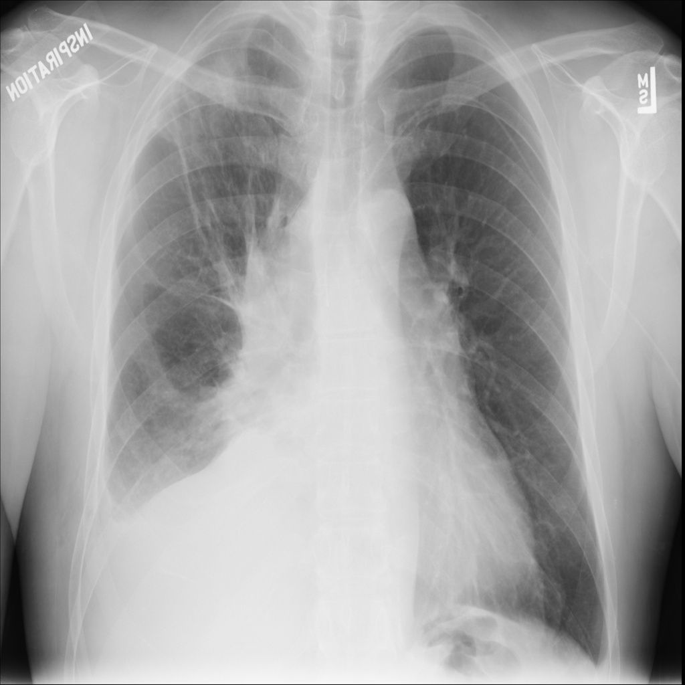
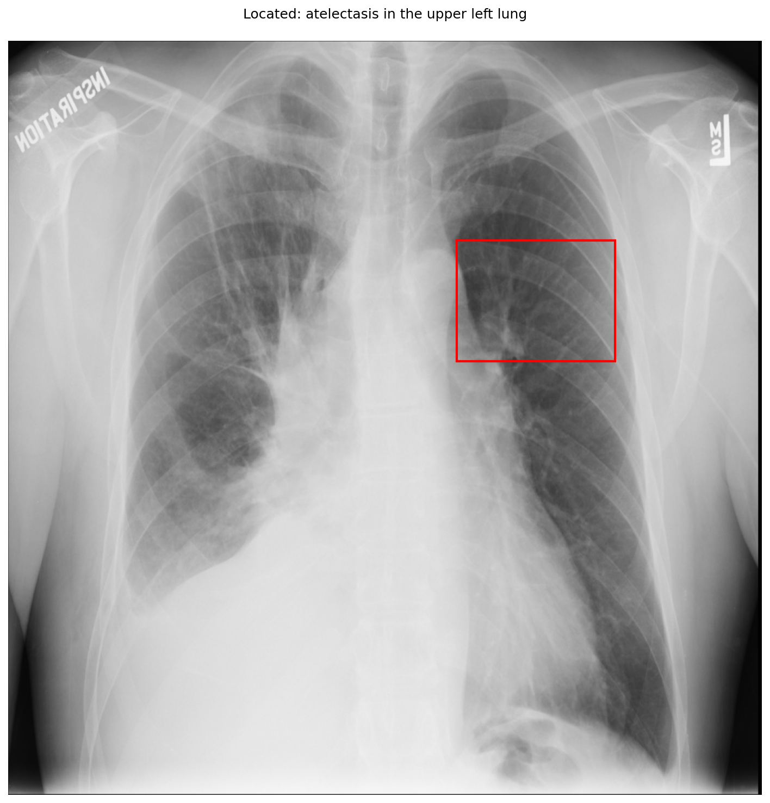

# chexbench_slake_0064
Ordinal 180; source SLAKE; stopped-prefix record.

Can atelectasis be observed on the upper left lung in this picture?

## Complete options

- **A**: no
- **B**: yes

## Original images

Explicit answer: **A. no**; reference: **A**; correct: **True**.

The upper left lung field appears clear and well-aerated without focal opacity or volume loss indicative of atelectasis.

[Prediction](../../evidence/chexbench/predictions/M43-IM-GT-S50-CXR6/chexbench_slake_0064.json) · [own post-prediction feedback](../../evidence/chexbench/feedback/chexbench_slake_0064.json) · [exact context and Skill version](../../evidence/chexbench/contexts/chexbench_slake_0064.json) · [all main requests/responses](../../evidence/chexbench/services/calls/R50-AGENT/chexbench_slake_0064)

## Tool requests and observations

- xray_phrase_grounding: status=completed; [selection](../../evidence/chexbench/services/tool_selections/R50-AGENT/chexbench_slake_0064/1.json), [full request/result/stdout/stderr artifacts](../../evidence/chexbench/services/tool_cache/8d85fa7efe9e14d949f4ef15ee2f2e1f76aead90417c8b2565a43793a0454148).

## Skill and prior-image provenance

Selected IDs: []; prior same-image IDs: ['chexbench_slake_0003', 'chexbench_slake_0019', 'chexbench_slake_0058'].

This is dataset-label scoring and model/tool narrative, not clinical adjudication or Skill causal verification.
