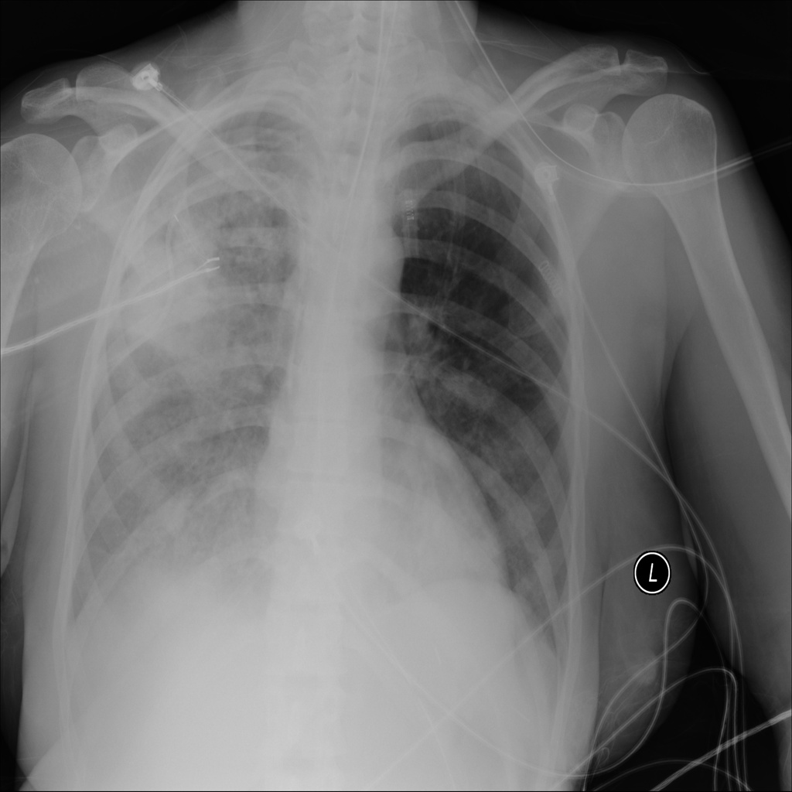

# chexbench_slake_0065
Ordinal 181; source SLAKE; stopped-prefix record.

Can pneumonia be observed on the left lung in this picture?

## Complete options

- **A**: yes
- **B**: no

## Original images

Explicit answer: **B. no**; reference: **B**; correct: **True**.

The left lung appears relatively clear without obvious consolidation or infiltrates, while significant opacity is present in the right lung.

[Prediction](../../evidence/chexbench/predictions/M43-IM-GT-S50-CXR6/chexbench_slake_0065.json) · [own post-prediction feedback](../../evidence/chexbench/feedback/chexbench_slake_0065.json) · [exact context and Skill version](../../evidence/chexbench/contexts/chexbench_slake_0065.json) · [all main requests/responses](../../evidence/chexbench/services/calls/R50-AGENT/chexbench_slake_0065)

## Tool requests and observations

- medgemma: status=completed; [selection](../../evidence/chexbench/services/tool_selections/R50-AGENT/chexbench_slake_0065/1.json), [full request/result/stdout/stderr artifacts](../../evidence/chexbench/services/tool_cache/a4d5cf78ecfec67610a86c7bd7885c853209aa614a7ff6fb0b0cc934757395bd).

## Skill and prior-image provenance

Selected IDs: []; prior same-image IDs: ['chexbench_slake_0038'].

This is dataset-label scoring and model/tool narrative, not clinical adjudication or Skill causal verification.
