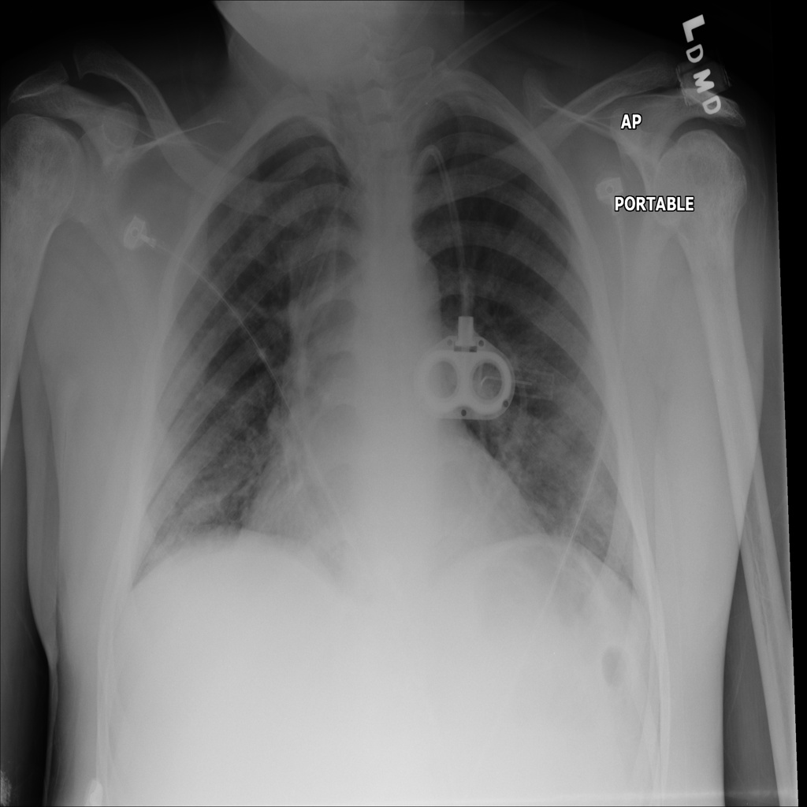

# chexbench_slake_0071
Ordinal 187; source SLAKE; stopped-prefix record.

Is this a coronal plane?

## Complete options

- **A**: no
- **B**: yes

## Original images

Explicit answer: **A. no**; reference: **B**; correct: **False**.

The image is labeled 'AP' and 'PORTABLE', indicating an anteroposterior projection, not a coronal plane CT or MRI slice.

[Prediction](../../evidence/chexbench/predictions/M43-IM-GT-S50-CXR6/chexbench_slake_0071.json) · [own post-prediction feedback](../../evidence/chexbench/feedback/chexbench_slake_0071.json) · [exact context and Skill version](../../evidence/chexbench/contexts/chexbench_slake_0071.json) · [all main requests/responses](../../evidence/chexbench/services/calls/R50-AGENT/chexbench_slake_0071)

## Tool requests and observations

## Skill and prior-image provenance

Selected IDs: []; prior same-image IDs: ['chexbench_slake_0001', 'chexbench_slake_0008', 'chexbench_slake_0060'].

This is dataset-label scoring and model/tool narrative, not clinical adjudication or Skill causal verification.
