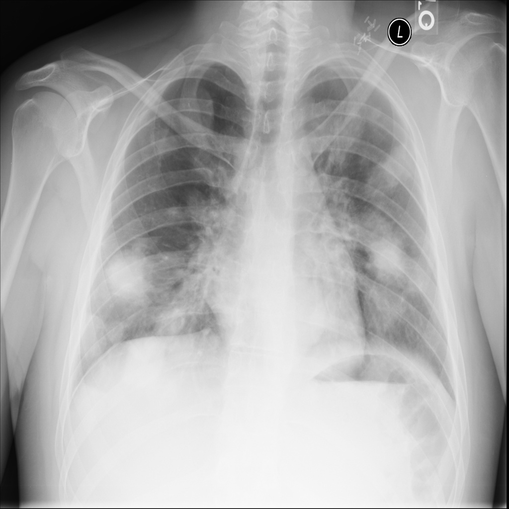
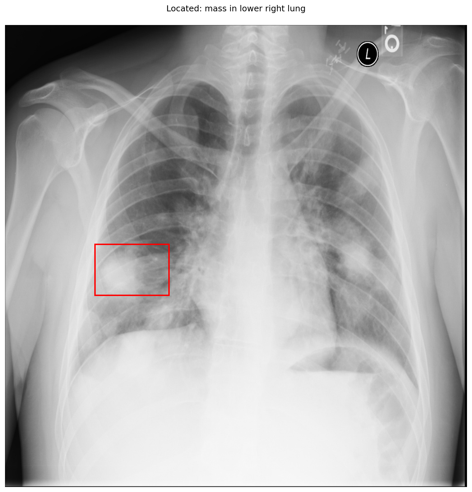

# chexbench_slake_0082
Ordinal 198; source SLAKE; stopped-prefix record.

Can mass be observed on the lower right lung in this picture?

## Complete options

- **A**: no
- **B**: yes

## Original images

Explicit answer: **B. yes**; reference: **B**; correct: **True**.

Phrase grounding localized a mass-like opacity in the lower right lung field, confirming its presence.

[Prediction](../../evidence/chexbench/predictions/M43-IM-GT-S50-CXR6/chexbench_slake_0082.json) · [own post-prediction feedback](../../evidence/chexbench/feedback/chexbench_slake_0082.json) · [exact context and Skill version](../../evidence/chexbench/contexts/chexbench_slake_0082.json) · [all main requests/responses](../../evidence/chexbench/services/calls/R50-AGENT/chexbench_slake_0082)

## Tool requests and observations

- xray_phrase_grounding: status=completed; [selection](../../evidence/chexbench/services/tool_selections/R50-AGENT/chexbench_slake_0082/1.json), [full request/result/stdout/stderr artifacts](../../evidence/chexbench/services/tool_cache/7d1de3ca001c36a8238f492a0ef7bff281880e5be8f105d48553976ff34f7d6e).

## Skill and prior-image provenance

Selected IDs: []; prior same-image IDs: [].

This is dataset-label scoring and model/tool narrative, not clinical adjudication or Skill causal verification.
