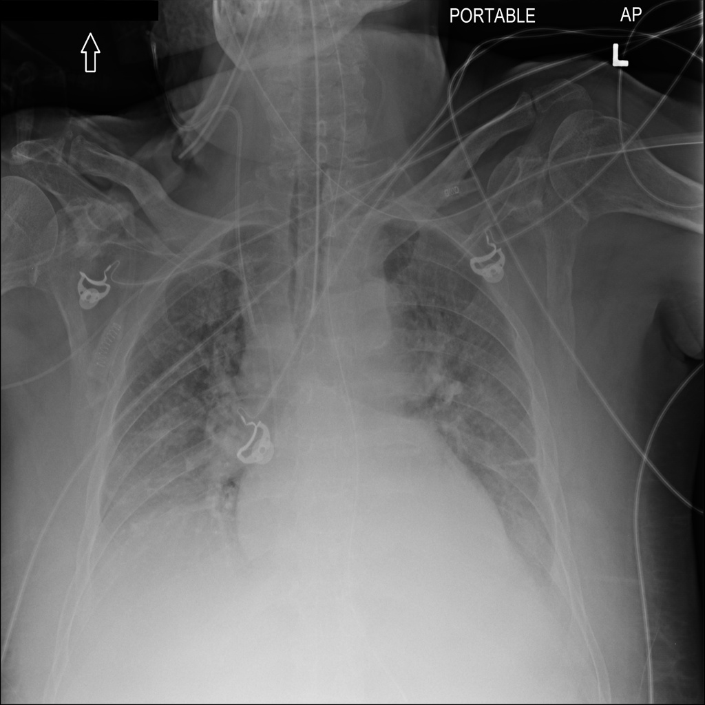
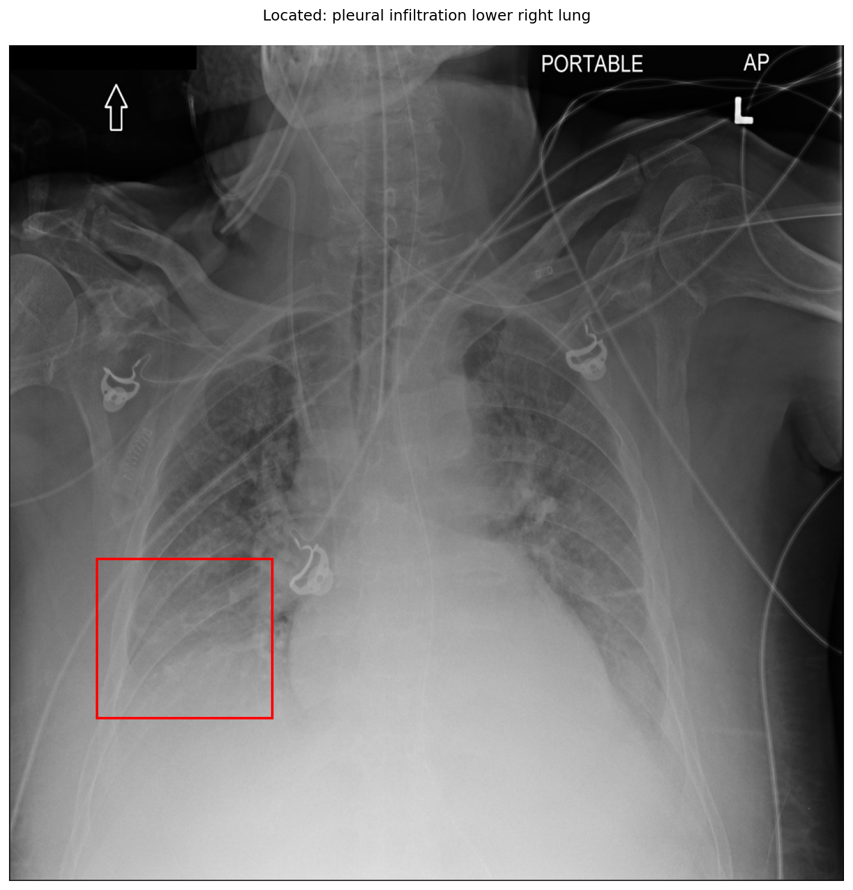

# chexbench_slake_0088
Ordinal 204; source SLAKE; stopped-prefix record.

Can pleural infiltration be observed on the lower right lung in this picture?

## Complete options

- **A**: no
- **B**: yes

## Original images

Explicit answer: **B. yes**; reference: **B**; correct: **True**.

The grounding tool localized pleural infiltration to the lower right lung (box [0.104, 0.614, 0.314, 0.805]), and visual inspection confirms increased opacity in that region consistent with pleural pathology.

[Prediction](../../evidence/chexbench/predictions/M43-IM-GT-S50-CXR6/chexbench_slake_0088.json) · [own post-prediction feedback](../../evidence/chexbench/feedback/chexbench_slake_0088.json) · [exact context and Skill version](../../evidence/chexbench/contexts/chexbench_slake_0088.json) · [all main requests/responses](../../evidence/chexbench/services/calls/R50-AGENT/chexbench_slake_0088)

## Tool requests and observations

- medgemma: status=completed; [selection](../../evidence/chexbench/services/tool_selections/R50-AGENT/chexbench_slake_0088/1.json), [full request/result/stdout/stderr artifacts](../../evidence/chexbench/services/tool_cache/adf46e0e4a75898b672690638bb61838b2bca74a0eb6387e0d0a7f6f4a99a36b).
- xray_phrase_grounding: status=completed; [selection](../../evidence/chexbench/services/tool_selections/R50-AGENT/chexbench_slake_0088/2.json), [full request/result/stdout/stderr artifacts](../../evidence/chexbench/services/tool_cache/2a151193476f322c44bdcce9b24f4220b8d81f6cf53a965c6fe4e50da7db8efc).

## Skill and prior-image provenance

Selected IDs: []; prior same-image IDs: ['chexbench_slake_0033'].

This is dataset-label scoring and model/tool narrative, not clinical adjudication or Skill causal verification.
