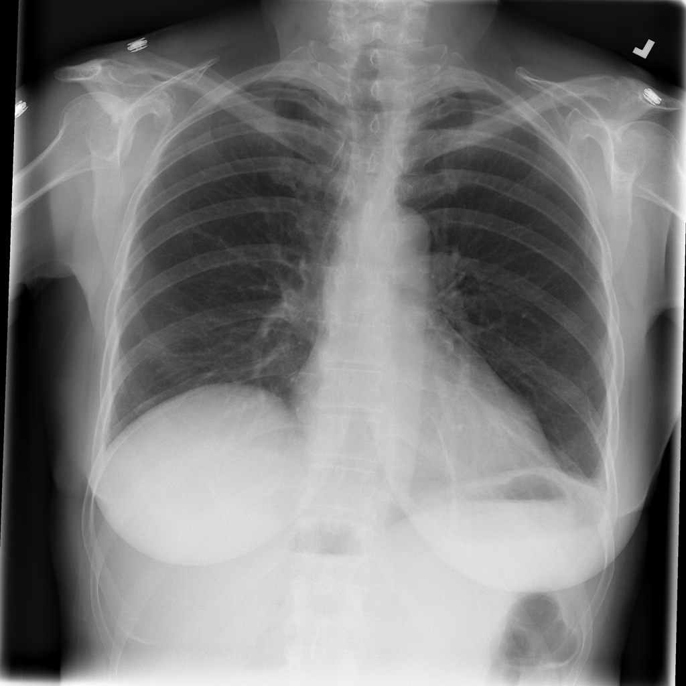
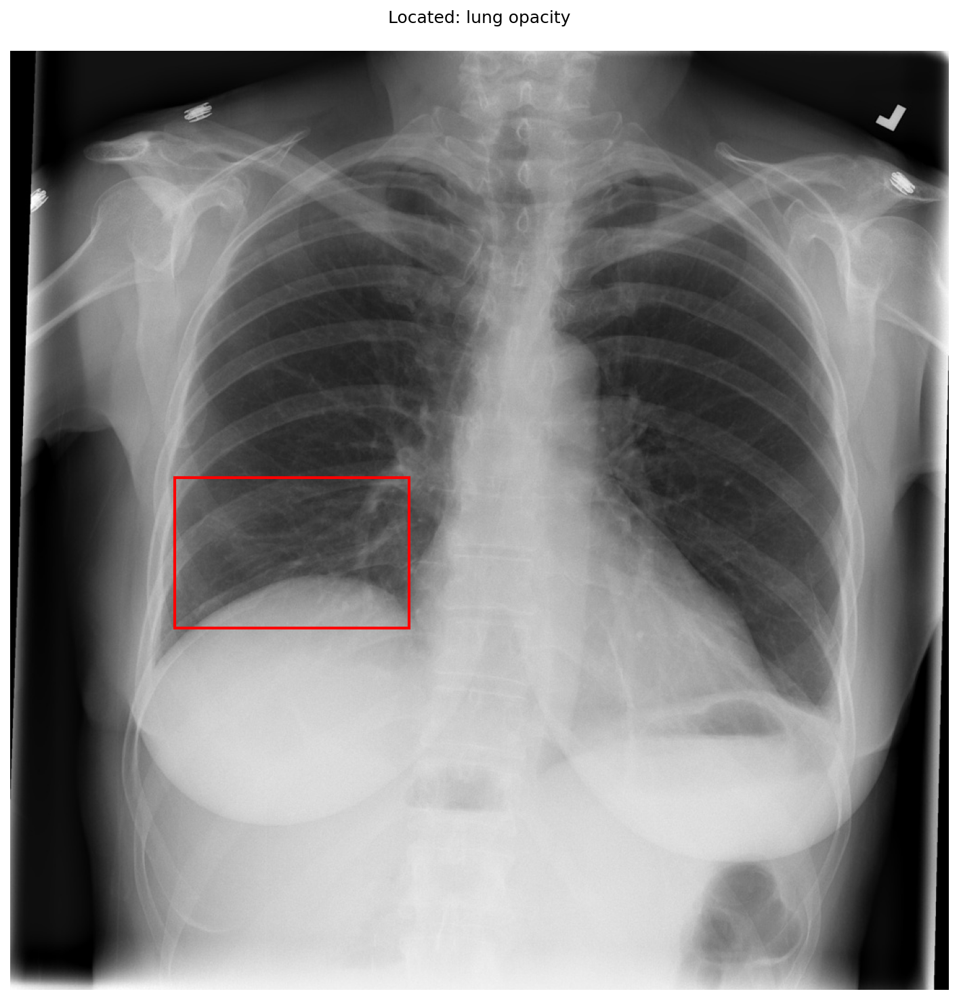

# chexbench_slake_0097
Ordinal 213; source SLAKE; stopped-prefix record.

Does the lung look unhealthy?

## Complete options

- **A**: yes
- **B**: no

## Original images

Explicit answer: **A. yes**; reference: **A**; correct: **True**.

Phrase grounding identified a lung opacity in the right lower lung field (coordinates [0.175, 0.455, 0.425, 0.615]), confirming an abnormality despite prior VLM reports of clear lungs.

[Prediction](../../evidence/chexbench/predictions/M43-IM-GT-S50-CXR6/chexbench_slake_0097.json) · [own post-prediction feedback](../../evidence/chexbench/feedback/chexbench_slake_0097.json) · [exact context and Skill version](../../evidence/chexbench/contexts/chexbench_slake_0097.json) · [all main requests/responses](../../evidence/chexbench/services/calls/R50-AGENT/chexbench_slake_0097)

## Tool requests and observations

- medgemma: status=completed; [selection](../../evidence/chexbench/services/tool_selections/R50-AGENT/chexbench_slake_0097/1.json), [full request/result/stdout/stderr artifacts](../../evidence/chexbench/services/tool_cache/41b9907978a2ed83c3a80bd7ec8f082589cdb5e5a04708a82dc04ef2422efd98).
- chest_xray_expert: status=completed; [selection](../../evidence/chexbench/services/tool_selections/R50-AGENT/chexbench_slake_0097/2.json), [full request/result/stdout/stderr artifacts](../../evidence/chexbench/services/tool_cache/55142c3f9e618e123e03ae717fe1f30e477b160dbdd2b0becde19bd76eba9807).
- llava_rad: status=completed; [selection](../../evidence/chexbench/services/tool_selections/R50-AGENT/chexbench_slake_0097/3.json), [full request/result/stdout/stderr artifacts](../../evidence/chexbench/services/tool_cache/e999974906d23ac2eadd395264ade358ee5fb433df7a0b8fca464afd34a6064a).
- xray_phrase_grounding: status=completed; [selection](../../evidence/chexbench/services/tool_selections/R50-AGENT/chexbench_slake_0097/4.json), [full request/result/stdout/stderr artifacts](../../evidence/chexbench/services/tool_cache/8a5e1a2d356a64abb198437c38428db2440eca2ab6cd1f32186615cb358886b3).

## Skill and prior-image provenance

Selected IDs: []; prior same-image IDs: ['chexbench_slake_0022'].

This is dataset-label scoring and model/tool narrative, not clinical adjudication or Skill causal verification.
