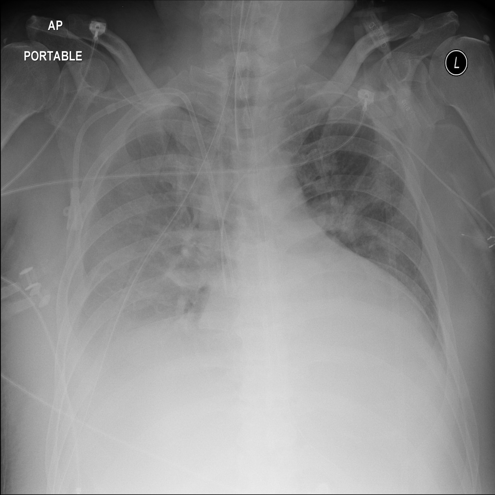

# chexbench_slake_0098
Ordinal 214; source SLAKE; stopped-prefix record.

Are there abnormalities in this image?

## Complete options

- **A**: yes
- **B**: no

## Original images

Explicit answer: **A. yes**; reference: **A**; correct: **True**.

The image shows clear abnormalities including right pleural effusion, left lower lobe opacity, and cardiomegaly.

[Prediction](../../evidence/chexbench/predictions/M43-IM-GT-S50-CXR6/chexbench_slake_0098.json) · [own post-prediction feedback](../../evidence/chexbench/feedback/chexbench_slake_0098.json) · [exact context and Skill version](../../evidence/chexbench/contexts/chexbench_slake_0098.json) · [all main requests/responses](../../evidence/chexbench/services/calls/R50-AGENT/chexbench_slake_0098)

## Tool requests and observations

## Skill and prior-image provenance

Selected IDs: []; prior same-image IDs: ['chexbench_slake_0056'].

This is dataset-label scoring and model/tool narrative, not clinical adjudication or Skill causal verification.
