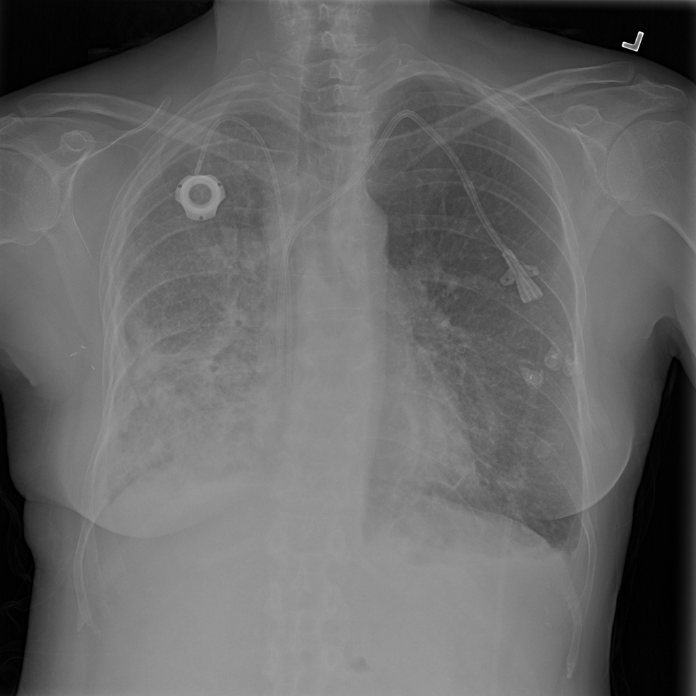

# chexbench_slake_0114
Ordinal 230; source SLAKE; stopped-prefix record.

Is this a study of the head?

## Complete options

- **A**: no
- **B**: yes

## Original images

Explicit answer: **A. no**; reference: **A**; correct: **True**.

The image is a chest X-ray showing thoracic anatomy, not the head.

[Prediction](../../evidence/chexbench/predictions/M43-IM-GT-S50-CXR6/chexbench_slake_0114.json) · [own post-prediction feedback](../../evidence/chexbench/feedback/chexbench_slake_0114.json) · [exact context and Skill version](../../evidence/chexbench/contexts/chexbench_slake_0114.json) · [all main requests/responses](../../evidence/chexbench/services/calls/R50-AGENT/chexbench_slake_0114)

## Tool requests and observations

## Skill and prior-image provenance

Selected IDs: []; prior same-image IDs: ['chexbench_slake_0000', 'chexbench_slake_0002', 'chexbench_slake_0045', 'chexbench_slake_0055', 'chexbench_slake_0087'].

This is dataset-label scoring and model/tool narrative, not clinical adjudication or Skill causal verification.
