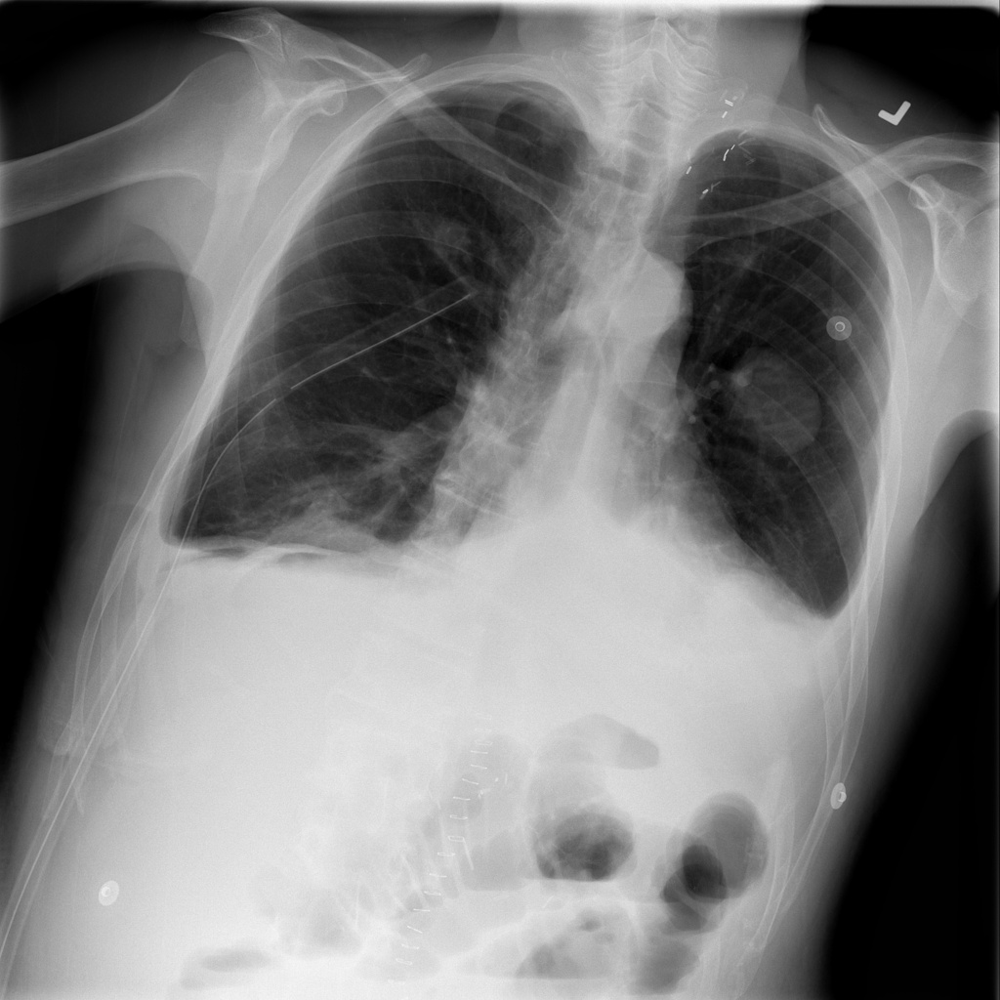
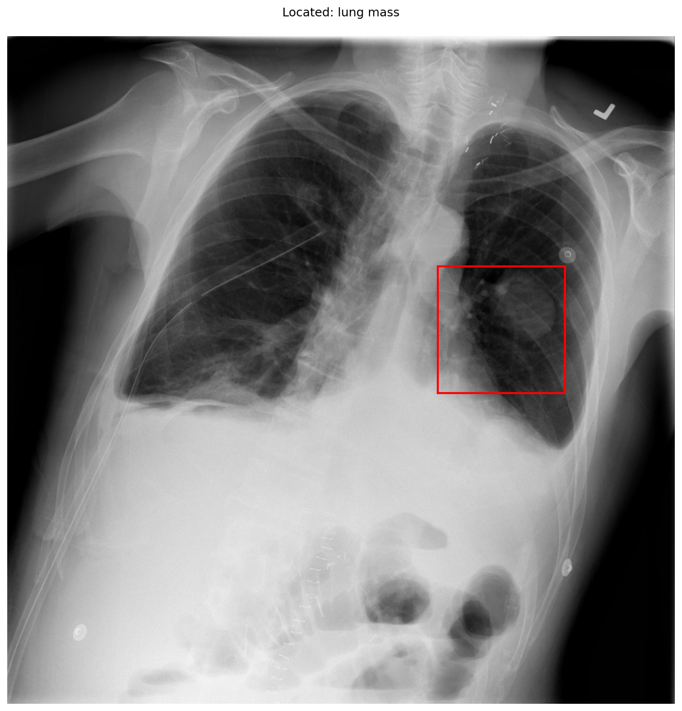

# chexbench_slake_0118
Ordinal 234; source SLAKE; stopped-prefix record.

Can mass be observed on the left lung in this picture?

## Complete options

- **A**: no
- **B**: yes

## Original images

Explicit answer: **B. yes**; reference: **B**; correct: **True**.

A discrete rounded opacity consistent with a lung mass is visible in the left mid-lung field, confirmed by grounding at coordinates [0.645, 0.345, 0.835, 0.535].

[Prediction](../../evidence/chexbench/predictions/M43-IM-GT-S50-CXR6/chexbench_slake_0118.json) · [own post-prediction feedback](../../evidence/chexbench/feedback/chexbench_slake_0118.json) · [exact context and Skill version](../../evidence/chexbench/contexts/chexbench_slake_0118.json) · [all main requests/responses](../../evidence/chexbench/services/calls/R50-AGENT/chexbench_slake_0118)

## Tool requests and observations

- xray_phrase_grounding: status=completed; [selection](../../evidence/chexbench/services/tool_selections/R50-AGENT/chexbench_slake_0118/1.json), [full request/result/stdout/stderr artifacts](../../evidence/chexbench/services/tool_cache/84ac0f820499c105ad08160525c3f741f087225d3a74961e8c95ce1a310d0a37).

## Skill and prior-image provenance

Selected IDs: []; prior same-image IDs: ['chexbench_slake_0016', 'chexbench_slake_0086'].

This is dataset-label scoring and model/tool narrative, not clinical adjudication or Skill causal verification.
