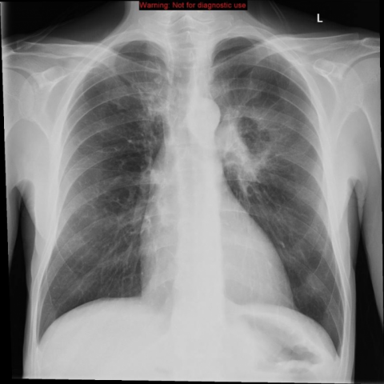

# 早期实验逐题档案：10416_8353800828856

独立评分参考选项：**B**。此页用于完成后的复盘，参考答案未反馈给历史推理过程。

[全部保留记录 JSON](10416_8353800828856.json) 包含逐轮终态、工具语义观察、检索记录与 V7 分支原文；每条带有来源文件。工具或模型的断言仍是待核实的观察。

## 原题与完整选项

Based on the chest X-ray findings in Figure 1, which of the following best describes the location and characterization of the opacities, and their potential implications in the context of the patient's clinical presentation?

A) The opacity at the left hilum is an anterior lesion in the left upper lobe, appearing well-circumscribed and dense, suggesting a benign etiology.
B) The opacity at the left hilum is a posterior lesion in the left lower lobe, appearing irregular with spiculated margins, indicating a malignant process consistent with metastasis.
C) The opacity in the right paratracheal location is a posterior lesion in the right upper lobe, with smooth margins, indicating an inflammatory process.
D) The opacity in the right paratracheal location is an anterior lesion in the right middle lobe, appearing irregular and dense, suggesting infectious consolidation.
E) Both opacities are located anteriorly, with smooth margins, and are likely due to lymphadenopathy related to sarcoidosis.
F) The opacity at the left hilum is an anterior lesion in the left upper lobe, with irregular margins, suggesting a malignant process consistent with metastasis.

## 原图

来源输入：`data/inference.jsonl`；实际路径：`cxr_003.png`。

来源输入：`data/memory_train_subset_v1.jsonl`；实际路径：`figures/10416/figure_1.jpg`。

## 当时保存的逐轮结果

备份/中断尝试单列，不能与最终完成版本相加。

| 来源 | 臂 | 选项 | 执行状态 | 参考匹配 |
|---|---|---|---|---|
| `diagnostic50_v1/results.jsonl` | direct | B | completed | 对 |
| `diagnostic50_v1/results.jsonl` | agent | F | completed | 未答对 |
| `multi_tool_first5_v1/results.jsonl` | direct | 缺答 | model_error | 未答对 |
| `multi_tool_first5_v1/results.jsonl` | agent | E | completed | 未答对 |
| `multi_tool_first5_withseg_v1/results.jsonl` | direct | B | completed | 对 |
| `multi_tool_first5_withseg_v1/results.jsonl` | agent | A | completed | 未答对 |
| `train60_full_r0/results.jsonl` | agent | F | completed | 未答对 |
| `train60_r0_v2/results.jsonl` | agent | F | completed | 未答对 |
| `train60_r0_v3/results.jsonl` | agent | F | completed | 未答对 |
| `v4_collect60/results.jsonl` | agent | F | completed | 未答对 |

保留的语义观察 5 条；检索记录 0 条；V7 恢复实验记录 0 条。详见同页 JSON。早期只有摘要/哈希的响应无法从哈希还原原文；此处未补写模型输出。
