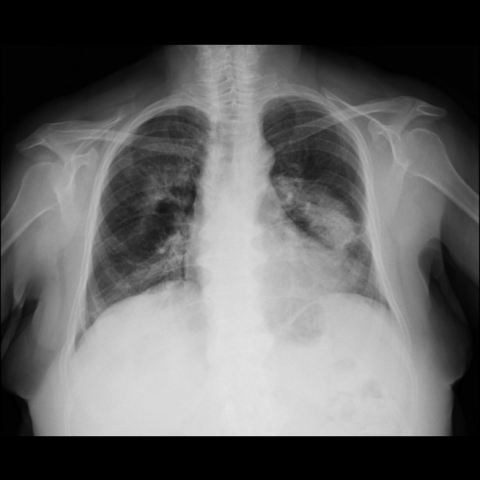

# 早期实验逐题档案：10483_8353800828031

独立评分参考选项：**B**。此页用于完成后的复盘，参考答案未反馈给历史推理过程。

[全部保留记录 JSON](10483_8353800828031.json) 包含逐轮终态、工具语义观察、检索记录与 V7 分支原文；每条带有来源文件。工具或模型的断言仍是待核实的观察。

## 原题与完整选项

Based on the analysis of the chest X-ray in Figure 1a, which of the following statements best characterizes the pattern of lung involvement and supports the diagnosis of Cryptogenic Organizing Pneumonia (COP) in this patient?

A) The chest X-ray shows unilateral patchy consolidations with a central distribution, sparing the peripheral lung fields, which are typical of COP.
B) The chest X-ray demonstrates bilateral patchy consolidations with peripheral and peribronchovascular distribution, consistent with COP.
C) The chest X-ray reveals bilateral nodular opacities with predominant involvement of the upper lobes, indicative of pulmonary sarcoidosis.
D) The chest X-ray shows diffuse ground-glass opacities without consolidation, which is characteristic of acute respiratory distress syndrome (ARDS).
E) The chest X-ray presents a solitary pulmonary nodule with smooth margins, typical of a benign lesion.
F) The chest X-ray depicts bilateral consolidations with cavitary lesions, suggesting a diagnosis of tuberculosis.

## 原图

来源输入：`data/validation_subset_v1.jsonl`；实际路径：`figures/10483/figure_1a.jpg`。

## 当时保存的逐轮结果

备份/中断尝试单列，不能与最终完成版本相加。

| 来源 | 臂 | 选项 | 执行状态 | 参考匹配 |
|---|---|---|---|---|
| `credit_r3_drop1/results.jsonl` | agent | B | completed | 对 |
| `s0_A/results.jsonl` | agent | B | completed | 对 |
| `s0_B/results.jsonl` | agent | B | completed | 对 |
| `s0_C/results.jsonl` | agent | B | completed | 对 |
| `val29_full_r0/results.jsonl` | agent | B | completed | 对 |
| `val29_full_r1/results.jsonl` | agent | B | completed | 对 |
| `val29_full_r2/results.jsonl` | agent | B | completed | 对 |
| `val29_full_r3/results.jsonl` | agent | B | completed | 对 |
| `val29_r1c_v1/results.jsonl` | agent | B | completed | 对 |
| `val29_r2_v1/results.jsonl` | agent | B | completed | 对 |
| `val29_r3_v1/results.jsonl` | agent | B | completed | 对 |
| `val30_r0_v1/results.jsonl` | agent | B | completed | 对 |
| `val30_r1_v1/results.jsonl` | agent | B | completed | 对 |
| `val30_r1b_v1/results.jsonl` | agent | B | completed | 对 |
| `val8_r0/results.jsonl` | agent | 缺答 | case_budget_exceeded | 未答对 |
| `val8_r1/results.jsonl` | agent | 缺答 | case_budget_exceeded | 未答对 |
| `val8_r5/results.jsonl` | agent | 缺答 | case_budget_exceeded | 未答对 |
| `val8_r57/results.jsonl` | agent | 缺答 | case_budget_exceeded | 未答对 |
| `val8b_r0/results.jsonl` | agent | B | completed | 对 |
| `val8b_r1/results.jsonl` | agent | B | completed | 对 |
| `val8b_r5/results.jsonl` | agent | B | completed | 对 |
| `val8b_r57/results.jsonl` | agent | B | completed | 对 |

保留的语义观察 13 条；检索记录 17 条；V7 恢复实验记录 0 条。详见同页 JSON。早期只有摘要/哈希的响应无法从哈希还原原文；此处未补写模型输出。
