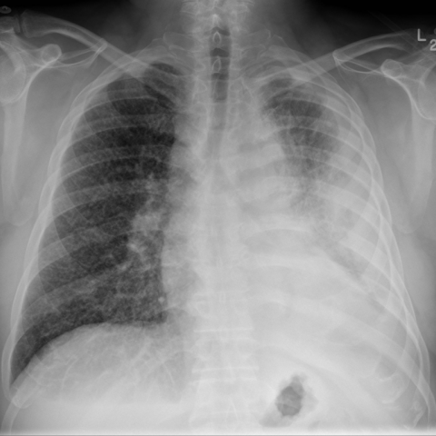

# 早期实验逐题档案：10569_8353800725393

独立评分参考选项：**B**。此页用于完成后的复盘，参考答案未反馈给历史推理过程。

[全部保留记录 JSON](10569_8353800725393.json) 包含逐轮终态、工具语义观察、检索记录与 V7 分支原文；每条带有来源文件。工具或模型的断言仍是待核实的观察。

## 原题与完整选项

Based on the chest X-ray images provided, which of the following best describes the changes observed in the patient's condition over the 6-month period, specifically focusing on the contralateral lung?  
A) There is a decrease in the number of miliary nodules in the right lung, suggesting a response to chemotherapy.  
B) There is an increase in the number and distribution of miliary nodules in the right lung, consistent with metastatic spread.  
C) The miliary nodules in the right lung remain unchanged, indicating a stable disease state.  
D) The right lung shows new large masses instead of miliary nodules, indicating a potential new primary malignancy.  
E) The right lung exhibits alveolar opacities rather than miliary nodules, suggesting an infectious process.  
F) There is no significant change in the pleural thickening of the left hemithorax.

## 原图

来源输入：`v4_validation60/inputs.jsonl`；实际路径：`figures/10569/figure_1a.jpg`。

来源输入：`v4_validation60/inputs.jsonl`；实际路径：`figures/10569/figure_1b.jpg`。

同一固定 60 题后续证据：[V10/V11 图文档案](../../../v11/cases/10569_8353800725393.md)。不同轮 P0 独立生成，不能把差异直接视为方法收益。

## 当时保存的逐轮结果

备份/中断尝试单列，不能与最终完成版本相加。

| 来源 | 臂 | 选项 | 执行状态 | 参考匹配 |
|---|---|---|---|---|
| `v4_A_r1/results.jsonl` | agent | B | completed | 对 |
| `v4_A_r1.pre-v9-203336/results.jsonl` | agent | B | completed | 对 |
| `v4_B_r1/results.jsonl` | agent | B | completed | 对 |
| `v4_B_r1/results.jsonl.bak-before-resume` | agent | B | completed | 对 |
| `v4_C_r1/results.jsonl` | agent | B | completed | 对 |
| `v7_recovery/round1.jsonl` | P0 | B | ok | 对 |
| `v7_recovery/round1.jsonl` | P1 | B | ok | 对 |
| `v7_recovery/round1.jsonl` | G1 | B | ok | 对 |
| `v7_recovery/round1.jsonl` | PB | B | ok | 对 |
| `v7_recovery/round1.jsonl` | GB | B | ok | 对 |
| `v7_recovery/round1.jsonl` | PC | B | ok | 对 |
| `v7_recovery/round1.jsonl` | GC | B | ok | 对 |
| `v7_recovery/round1_propose.jsonl` | P0 | B | ok | 对 |
| `v7_recovery/round1_propose.jsonl` | P1 | C | ok | 未答对 |
| `v7_recovery/round1_propose.jsonl` | G1 | B | ok | 对 |
| `v7_recovery/round1_propose.jsonl` | PB | B | ok | 对 |
| `v7_recovery/round1_propose.jsonl` | GB | B | ok | 对 |
| `v7_recovery/round1_propose.jsonl` | PC | B | ok | 对 |
| `v7_recovery/round1_propose.jsonl` | GC | B | ok | 对 |
| `v7_recovery/round2_verify.jsonl` | P0 | B | ok | 对 |
| `v7_recovery/round2_verify.jsonl` | PB | B | ok | 对 |
| `v7_recovery/round2_verify.jsonl` | GB | B | ok | 对 |
| `v7_recovery/round2_verify.jsonl` | PC | B | ok | 对 |
| `v7_recovery/round2_verify.jsonl` | GC | B | ok | 对 |
| `v7_recovery/round2_verify.jsonl` | P1 | 缺答 | ok | 未答对 |
| `v7_recovery/smoke1.jsonl` | P0 | B | ok | 对 |
| `v7_recovery/smoke1.jsonl` | P1 | B | ok | 对 |
| `v7_recovery/smoke1.jsonl` | G1 | B | ok | 对 |
| `v7_recovery/smoke1.jsonl` | PB | B | ok | 对 |
| `v7_recovery/smoke1.jsonl` | GB | B | ok | 对 |
| `v7_recovery/smoke1.jsonl` | PC | B | ok | 对 |
| `v7_recovery/smoke1.jsonl` | GC | B | ok | 对 |

保留的语义观察 32 条；检索记录 2 条；V7 恢复实验记录 4 条。详见同页 JSON。早期只有摘要/哈希的响应无法从哈希还原原文；此处未补写模型输出。
