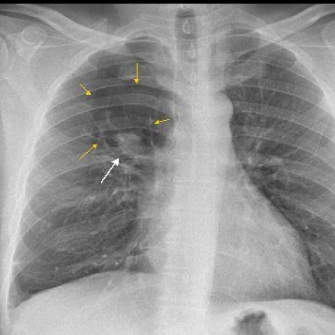

# 早期实验逐题档案：10974_8353800724898

独立评分参考选项：**B**。此页用于完成后的复盘，参考答案未反馈给历史推理过程。

[全部保留记录 JSON](10974_8353800724898.json) 包含逐轮终态、工具语义观察、检索记录与 V7 分支原文；每条带有来源文件。工具或模型的断言仍是待核实的观察。

## 原题与完整选项

Based on the chest X-ray findings in Figure 1, which of the following best describes the radiographic features that support the diagnosis of bronchial atresia in this patient?

A) A round opacity in the right upper lung zone with surrounding normal lung parenchyma and abundant vasculature.
B) A tubular or nodular opacity extending from the hilum in the right upper lung zone surrounded by hyperlucent lung parenchyma with decreased vascular markings.
C) A small solitary nodule in the right upper lung zone with surrounding dense lung parenchyma and increased vascular markings.
D) A large mass in the right upper lung zone with multiple calcifications and surrounding hyperlucent lung parenchyma.
E) A diffuse opacity in both upper lung zones with normal vascular markings and no areas of hyperlucency.
F) A linear opacity in the right lower lung zone with surrounding normal lung parenchyma and increased vascular markings.

## 原图

来源输入：`data/inference.jsonl`；实际路径：`cxr_013.png`。

来源输入：`data/memory_train_subset_v1.jsonl`；实际路径：`figures/10974/figure_1.jpg`。

## 当时保存的逐轮结果

备份/中断尝试单列，不能与最终完成版本相加。

| 来源 | 臂 | 选项 | 执行状态 | 参考匹配 |
|---|---|---|---|---|
| `diagnostic50_v1/results.jsonl` | direct | B | completed | 对 |
| `diagnostic50_v1/results.jsonl` | agent | B | completed | 对 |
| `length_cap1024_v1/results.jsonl` | direct | B | completed | 对 |
| `length_cap1024_v1/results.jsonl` | agent | B | completed | 对 |
| `train60_full_r0/results.jsonl` | agent | 缺答 | case_budget_exceeded | 未答对 |
| `train60_r0_v2/results.jsonl` | agent | B | completed | 对 |
| `train60_r0_v3/results.jsonl` | agent | B | completed | 对 |
| `v4_collect60/results.jsonl` | agent | B | completed | 对 |

保留的语义观察 6 条；检索记录 0 条；V7 恢复实验记录 0 条。详见同页 JSON。早期只有摘要/哈希的响应无法从哈希还原原文；此处未补写模型输出。
