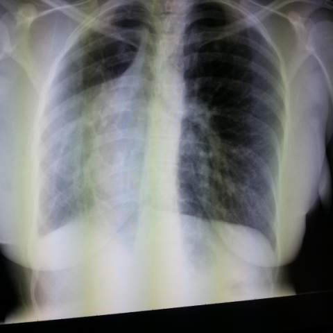

# 早期实验逐题档案：11167_8353800750732

独立评分参考选项：**B**。此页用于完成后的复盘，参考答案未反馈给历史推理过程。

[全部保留记录 JSON](11167_8353800750732.json) 包含逐轮终态、工具语义观察、检索记录与 V7 分支原文；每条带有来源文件。工具或模型的断言仍是待核实的观察。

## 原题与完整选项

Based on the chest X-ray findings, which of the following best describes the anatomical relationship and reasoning for the observed mediastinal shift in Figure 1?

A) The mediastinal shift is due to right lung hyperexpansion and left-sided dextrocardia.
B) The mediastinal shift is caused by volume loss in the right hemithorax with compensatory left lung expansion.
C) The mediastinal shift is due to a mass in the right lung causing leftward displacement.
D) The mediastinal shift is due to bilateral lung hyperplasia, pushing the mediastinum to the right.
E) The mediastinal shift is caused by left lung collapse with compensatory right lung hyperexpansion.

## 原图

来源输入：`data/inference.jsonl`；实际路径：`cxr_016.png`。

来源输入：`data/memory_train_subset_v1.jsonl`；实际路径：`figures/11167/figure_1.jpg`。

## 当时保存的逐轮结果

备份/中断尝试单列，不能与最终完成版本相加。

| 来源 | 臂 | 选项 | 执行状态 | 参考匹配 |
|---|---|---|---|---|
| `diagnostic50_v1/results.jsonl` | agent | B | completed | 对 |
| `diagnostic50_v1/results.jsonl` | direct | E | completed | 未答对 |
| `length_cap1024_v1/results.jsonl` | agent | B | completed | 对 |
| `length_cap1024_v1/results.jsonl` | direct | E | completed | 未答对 |
| `train60_full_r0/results.jsonl` | agent | 缺答 | case_budget_exceeded | 未答对 |
| `train60_r0_v2/results.jsonl` | agent | E | completed | 未答对 |
| `train60_r0_v3/results.jsonl` | agent | B | completed | 对 |
| `v4_collect60/results.jsonl` | agent | E | completed | 未答对 |

保留的语义观察 4 条；检索记录 0 条；V7 恢复实验记录 0 条。详见同页 JSON。早期只有摘要/哈希的响应无法从哈希还原原文；此处未补写模型输出。
