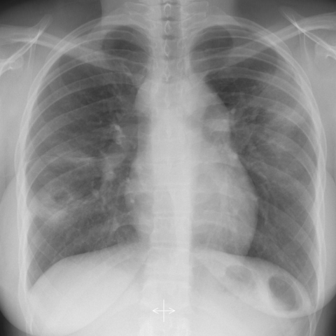

# 早期实验逐题档案：11491_8353800763489

独立评分参考选项：**B**。此页用于完成后的复盘，参考答案未反馈给历史推理过程。

[全部保留记录 JSON](11491_8353800763489.json) 包含逐轮终态、工具语义观察、检索记录与 V7 分支原文；每条带有来源文件。工具或模型的断言仍是待核实的观察。

## 原题与完整选项

Based on the chest X-ray findings, which of the following best describes the pattern of lung involvement and lymph node enlargement in this patient, and what is the most likely diagnosis?
A) Multiple nodular airspace opacities with asymmetrical hilar lymph node enlargement suggestive of tuberculosis.
B) Multiple nodular airspace opacities with symmetrical hilar lymph node enlargement suggestive of sarcoidosis.
C) Diffuse airspace opacities with mediastinal lymph node enlargement consistent with lymphoma.
D) Patchy airspace opacities with no lymph node enlargement indicative of organizing pneumonia.
E) Dense consolidation with central necrosis and mediastinal lymph node enlargement consistent with pulmonary embolism.
F) Predominantly peripheral opacities with mediastinal lymph node enlargement suggestive of fungal infection.

## 原图

来源输入：`data/inference.jsonl`；实际路径：`cxr_022.png`。

来源输入：`data/memory_train_subset_v1.jsonl`；实际路径：`figures/11491/figure_1.jpg`。

## 当时保存的逐轮结果

备份/中断尝试单列，不能与最终完成版本相加。

| 来源 | 臂 | 选项 | 执行状态 | 参考匹配 |
|---|---|---|---|---|
| `diagnostic50_v1/results.jsonl` | agent | F | completed | 未答对 |
| `diagnostic50_v1/results.jsonl` | direct | B | completed | 对 |
| `train60_full_r0/results.jsonl` | agent | B | completed | 对 |
| `train60_r0_v2/results.jsonl` | agent | B | completed | 对 |
| `train60_r0_v3/results.jsonl` | agent | B | completed | 对 |

保留的语义观察 0 条；检索记录 0 条；V7 恢复实验记录 0 条。详见同页 JSON。早期只有摘要/哈希的响应无法从哈希还原原文；此处未补写模型输出。
