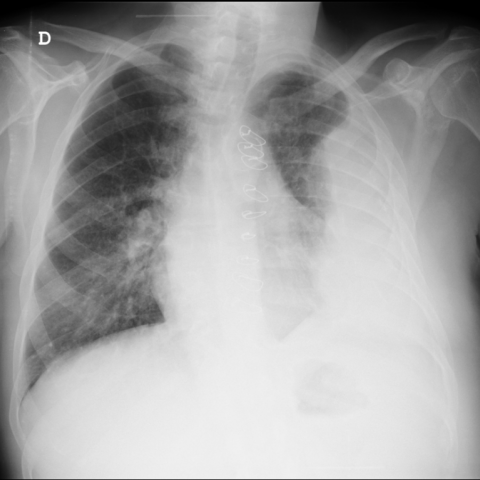

# 早期实验逐题档案：11547_8353800750792

独立评分参考选项：**D**。此页用于完成后的复盘，参考答案未反馈给历史推理过程。

[全部保留记录 JSON](11547_8353800750792.json) 包含逐轮终态、工具语义观察、检索记录与 V7 分支原文；每条带有来源文件。工具或模型的断言仍是待核实的观察。

## 原题与完整选项

In Figure 1, which of the following accurately describes the localization, size, and relationship of the identified findings in the chest X-ray in the context of the patient's clinical history of pulmonary tuberculosis?

A) The loculated pleural effusion is positioned in the right hemithorax and shows a larger size compared to the soft-tissue opacity in the right chest wall, indicating a potential infectious process unrelated to the patient's previous tuberculosis.

B) The loculated pleural effusion is positioned in the left hemithorax and is smaller in size compared to the soft-tissue opacity in the left chest wall, suggesting a possible communication between the two consistent with empyema necessitans as a reactivation of tuberculosis.

C) The loculated pleural effusion is positioned in the left hemithorax and is similar in size to the soft-tissue opacity in the left chest wall, indicating a benign process unrelated to tuberculosis.

D) The loculated pleural effusion is positioned in the left hemithorax and is larger in size compared to the soft-tissue opacity in the left chest wall, suggesting a potential communication between the two consistent with empyema necessitans as a reactivation of tuberculosis.

E) The loculated pleural effusion is positioned in the left hemithorax and shows no size relationship to the soft-tissue opacity in the right chest wall, indicating an unrelated pathological process.

F) The loculated pleural effusion is positioned in the right hemithorax and is smaller in size compared to the soft-tissue opacity in the left chest wall, suggesting a potential communication between the two consistent with empyema necessitans as a reactivation of tuberculosis.

## 原图

来源输入：`data/inference.jsonl`；实际路径：`cxr_024.png`。

来源输入：`data/memory_train_subset_v1.jsonl`；实际路径：`figures/11547/figure_1.jpg`。

## 当时保存的逐轮结果

备份/中断尝试单列，不能与最终完成版本相加。

| 来源 | 臂 | 选项 | 执行状态 | 参考匹配 |
|---|---|---|---|---|
| `diagnostic50_v1/results.jsonl` | agent | D | completed | 对 |
| `diagnostic50_v1/results.jsonl` | direct | D | completed | 对 |
| `train60_full_r0/results.jsonl` | agent | D | completed | 对 |
| `train60_r0_v2/results.jsonl` | agent | D | completed | 对 |
| `train60_r0_v3/results.jsonl` | agent | D | completed | 对 |

保留的语义观察 0 条；检索记录 0 条；V7 恢复实验记录 0 条。详见同页 JSON。早期只有摘要/哈希的响应无法从哈希还原原文；此处未补写模型输出。
