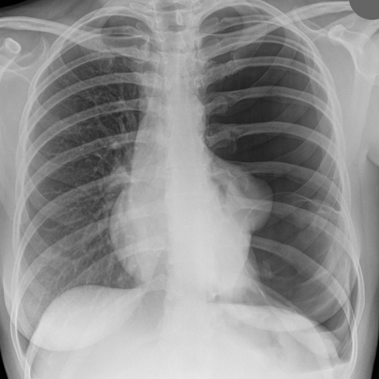
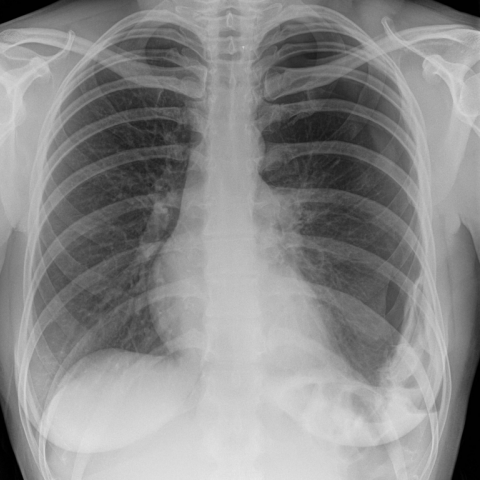

# 早期实验逐题档案：11624_8353800763402

独立评分参考选项：**C**。此页用于完成后的复盘，参考答案未反馈给历史推理过程。

[全部保留记录 JSON](11624_8353800763402.json) 包含逐轮终态、工具语义观察、检索记录与 V7 分支原文；每条带有来源文件。工具或模型的断言仍是待核实的观察。

## 原题与完整选项

Based on the chest X-ray images provided, which of the following best describes the changes observed in the left lung from Figure 1 to Figure 3, and the underlying reasoning for these observations?

A) Figure 1 shows a large left-sided pneumothorax and a cystic structure, and Figure 3 shows complete resolution of the pneumothorax with no cystic changes, indicating successful drainage and healing without residual cyst.

B) Figure 1 shows a large left-sided pneumothorax and a cystic structure, and Figure 3 shows a re-expansion of the left lung with disappearance of the cystic structure, indicating that the structure was likely a bullae that resolved with the pneumothorax.

C) Figure 1 shows a large left-sided pneumothorax and a cystic structure, and Figure 3 shows a recurrent pneumothorax with a persistent cystic structure, suggesting a bronchogenic cyst that contributes to recurrent pneumothorax due to its rupture.

D) Figure 1 shows a large left-sided pneumothorax and a cystic structure, and Figure 3 shows a stable lung with no pneumothorax, but a new opacity in the left lower zone, indicating an infection or abscess formation in the previously cystic area.

E) Figure 1 shows a large left-sided pneumothorax and a cystic structure, and Figure 3 shows a shrinking pneumothorax and disappearance of the cystic structure, suggesting that the cystic structure was a fluid collection that resolved spontaneously.

## 原图

来源输入：`v4_validation60/inputs.jsonl`；实际路径：`figures/11624/figure_1.jpg`。

来源输入：`v4_validation60/inputs.jsonl`；实际路径：`figures/11624/figure_3.jpg`。

同一固定 60 题后续证据：[V10/V11 图文档案](../../../v11/cases/11624_8353800763402.md)。不同轮 P0 独立生成，不能把差异直接视为方法收益。

## 当时保存的逐轮结果

备份/中断尝试单列，不能与最终完成版本相加。

| 来源 | 臂 | 选项 | 执行状态 | 参考匹配 |
|---|---|---|---|---|
| `v4_A_r1/results.jsonl` | agent | B | completed | 未答对 |
| `v4_A_r1.pre-v9-203336/results.jsonl` | agent | B | completed | 未答对 |
| `v4_B_r1/results.jsonl` | agent | B | completed | 未答对 |
| `v4_B_r1/results.jsonl.bak-before-resume` | agent | B | completed | 未答对 |
| `v4_C_r1/results.jsonl` | agent | B | completed | 未答对 |
| `v7_recovery/round1.jsonl` | P0 | B | ok | 未答对 |
| `v7_recovery/round1.jsonl` | P1 | B | ok | 未答对 |
| `v7_recovery/round1.jsonl` | G1 | B | ok | 未答对 |
| `v7_recovery/round1.jsonl` | PB | B | ok | 未答对 |
| `v7_recovery/round1.jsonl` | GB | B | ok | 未答对 |
| `v7_recovery/round1.jsonl` | PC | B | ok | 未答对 |
| `v7_recovery/round1.jsonl` | GC | B | ok | 未答对 |
| `v7_recovery/round1_propose.jsonl` | P0 | B | ok | 未答对 |
| `v7_recovery/round1_propose.jsonl` | P1 | B | ok | 未答对 |
| `v7_recovery/round1_propose.jsonl` | G1 | B | ok | 未答对 |
| `v7_recovery/round1_propose.jsonl` | PB | B | ok | 未答对 |
| `v7_recovery/round1_propose.jsonl` | GB | B | ok | 未答对 |
| `v7_recovery/round1_propose.jsonl` | PC | B | ok | 未答对 |
| `v7_recovery/round1_propose.jsonl` | GC | B | ok | 未答对 |
| `v7_recovery/round2_verify.jsonl` | P0 | B | ok | 未答对 |
| `v7_recovery/round2_verify.jsonl` | P1 | B | ok | 未答对 |
| `v7_recovery/round2_verify.jsonl` | G1 | B | ok | 未答对 |
| `v7_recovery/round2_verify.jsonl` | PB | B | ok | 未答对 |
| `v7_recovery/round2_verify.jsonl` | GB | B | ok | 未答对 |
| `v7_recovery/round2_verify.jsonl` | PC | B | ok | 未答对 |
| `v7_recovery/round2_verify.jsonl` | GC | B | ok | 未答对 |

保留的语义观察 25 条；检索记录 2 条；V7 恢复实验记录 3 条。详见同页 JSON。早期只有摘要/哈希的响应无法从哈希还原原文；此处未补写模型输出。
