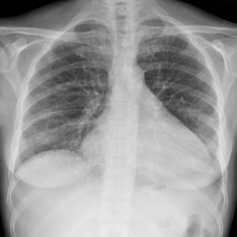

# 早期实验逐题档案：11919_8353800664242

独立评分参考选项：**A**。此页用于完成后的复盘，参考答案未反馈给历史推理过程。

[全部保留记录 JSON](11919_8353800664242.json) 包含逐轮终态、工具语义观察、检索记录与 V7 分支原文；每条带有来源文件。工具或模型的断言仍是待核实的观察。

## 原题与完整选项

Based on the chest X-ray (Figure 3), which of the following combinations of findings is most consistent with the pulmonary involvement seen in Erdheim-Chester disease, and what is their potential impact on the patient's symptoms of shortness of breath and dry cough?

A) Diffuse interstitial involvement, fissural thickening, and enlarged cardiac image; these findings suggest pulmonary congestion leading to the patient's symptoms.
B) Alveolar consolidation and pleural effusion; these findings suggest bacterial pneumonia as a cause of the symptoms.
C) Diffuse interstitial involvement and normal cardiac silhouette; these findings indicate interstitial lung disease unrelated to cardiac issues.
D) Diffuse interstitial involvement, fissural thickening, and normal cardiac image; these findings suggest non-cardiogenic pulmonary edema.
E) Focal nodular opacities and enlarged cardiac image; these findings indicate possible neoplastic process causing the symptoms.
F) Pleural thickening and normal cardiac silhouette; these findings suggest chronic pleural disease as the cause of symptoms.

## 原图

来源输入：`data/inference.jsonl`；实际路径：`cxr_028.png`。

来源输入：`data/memory_train_subset_v1.jsonl`；实际路径：`figures/11919/figure_3.jpg`。

## 当时保存的逐轮结果

备份/中断尝试单列，不能与最终完成版本相加。

| 来源 | 臂 | 选项 | 执行状态 | 参考匹配 |
|---|---|---|---|---|
| `diagnostic50_v1/results.jsonl` | agent | A | completed | 对 |
| `diagnostic50_v1/results.jsonl` | direct | D | completed | 未答对 |
| `train60_full_r0/results.jsonl` | agent | 缺答 | case_budget_exceeded | 未答对 |
| `train60_r0_v2/results.jsonl` | agent | D | completed | 未答对 |
| `train60_r0_v3/results.jsonl` | agent | D | completed | 未答对 |

保留的语义观察 0 条；检索记录 0 条；V7 恢复实验记录 0 条。详见同页 JSON。早期只有摘要/哈希的响应无法从哈希还原原文；此处未补写模型输出。
