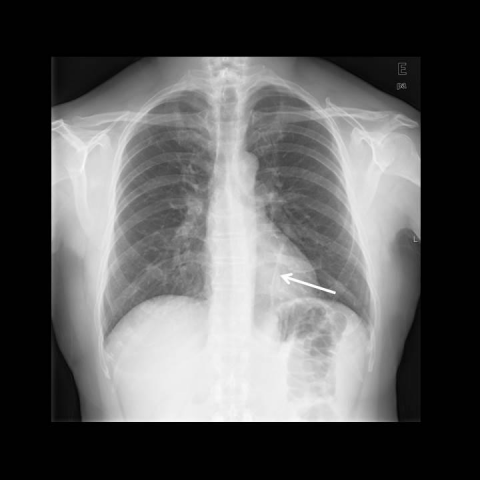

# 早期实验逐题档案：11945_8353800664257

独立评分参考选项：**C**。此页用于完成后的复盘，参考答案未反馈给历史推理过程。

[全部保留记录 JSON](11945_8353800664257.json) 包含逐轮终态、工具语义观察、检索记录与 V7 分支原文；每条带有来源文件。工具或模型的断言仍是待核实的观察。

## 原题与完整选项

Based on the chest X-ray in Figure 1, which option correctly describes the position and potential clinical implications of the migrated catheter fragment (indicated by an arrow) after the removal of the central venous catheter (CVC)?

A) The fragment is located in the right atrium and poses a high risk of embolism, requiring immediate intervention.
B) The fragment is located in the superior vena cava, suggesting a low risk of embolism and minimal clinical intervention.
C) The fragment is in the descending branch of the left pulmonary artery, which is frequently asymptomatic and aligns with the decision for imaging follow-up.
D) The fragment is located in the left atrium, which could lead to potential embolism and requires surgical removal.
E) The fragment is in the right pulmonary artery, causing increased intrathoracic pressure and necessitating removal.
F) The fragment is lodged in the left pulmonary vein, suggesting a high risk of systemic embolism.

## 原图

来源输入：`data/inference.jsonl`；实际路径：`cxr_029.png`。

来源输入：`data/memory_train_subset_v1.jsonl`；实际路径：`figures/11945/figure_1.jpg`。

## 当时保存的逐轮结果

备份/中断尝试单列，不能与最终完成版本相加。

| 来源 | 臂 | 选项 | 执行状态 | 参考匹配 |
|---|---|---|---|---|
| `diagnostic50_v1/results.jsonl` | direct | C | completed | 对 |
| `diagnostic50_v1/results.jsonl` | agent | C | completed | 对 |
| `train60_full_r0/results.jsonl` | agent | C | completed | 对 |
| `train60_r0_v2/results.jsonl` | agent | C | completed | 对 |
| `train60_r0_v3/results.jsonl` | agent | C | completed | 对 |

保留的语义观察 0 条；检索记录 0 条；V7 恢复实验记录 0 条。详见同页 JSON。早期只有摘要/哈希的响应无法从哈希还原原文；此处未补写模型输出。
