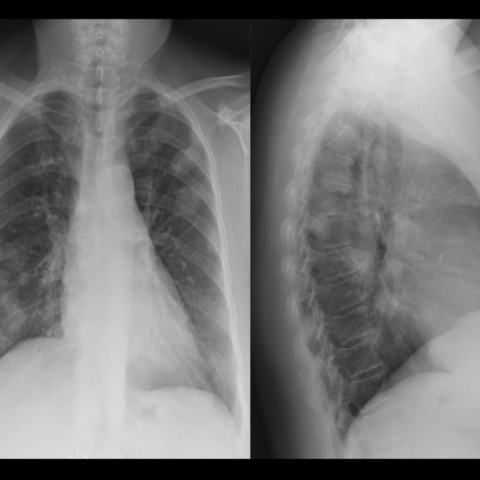

# 早期实验逐题档案：11988_8353800664521

独立评分参考选项：**B**。此页用于完成后的复盘，参考答案未反馈给历史推理过程。

[全部保留记录 JSON](11988_8353800664521.json) 包含逐轮终态、工具语义观察、检索记录与 V7 分支原文；每条带有来源文件。工具或模型的断言仍是待核实的观察。

## 原题与完整选项

Based on the preoperative chest X-ray findings (Fig. 2), what is the most likely pattern of nodular distribution, and what does this suggest about the underlying condition in the context of localized pulmonary amyloidosis?

A) Central distribution of nodules, suggesting tracheobronchial involvement typical of systemic amyloidosis.
B) Peripheral distribution of nodules, suggesting nodular parenchymal involvement typical of localized pulmonary amyloidosis.
C) Diffuse distribution of nodules, suggesting diffuse alveolar septal involvement typical of Sjögren syndrome.
D) Unilateral distribution of nodules, suggesting metastatic disease.
E) Random distribution of nodules, suggesting septic pulmonary embolism.
F) Confluent nodular distribution, suggesting granulomatous disease.

## 原图

来源输入：`data/validation_subset_v1.jsonl`；实际路径：`figures/11988/figure_2.jpg`。

## 当时保存的逐轮结果

备份/中断尝试单列，不能与最终完成版本相加。

| 来源 | 臂 | 选项 | 执行状态 | 参考匹配 |
|---|---|---|---|---|
| `credit_r3_drop1/results.jsonl` | agent | B | completed | 对 |
| `s0_A/results.jsonl` | agent | B | completed | 对 |
| `s0_B/results.jsonl` | agent | B | completed | 对 |
| `s0_C/results.jsonl` | agent | B | completed | 对 |
| `val29_full_r0/results.jsonl` | agent | B | completed | 对 |
| `val29_full_r1/results.jsonl` | agent | B | completed | 对 |
| `val29_full_r2/results.jsonl` | agent | B | completed | 对 |
| `val29_full_r3/results.jsonl` | agent | B | completed | 对 |
| `val29_r1c_v1/results.jsonl` | agent | B | completed | 对 |
| `val29_r2_v1/results.jsonl` | agent | B | completed | 对 |
| `val29_r3_v1/results.jsonl` | agent | B | completed | 对 |
| `val30_r0_v1/results.jsonl` | agent | B | completed | 对 |
| `val30_r1_v1/results.jsonl` | agent | B | completed | 对 |
| `val30_r1b_v1/results.jsonl` | agent | B | completed | 对 |
| `val8_r0/results.jsonl` | agent | B | completed | 对 |
| `val8_r1/results.jsonl` | agent | B | completed | 对 |
| `val8_r5/results.jsonl` | agent | B | completed | 对 |
| `val8_r57/results.jsonl` | agent | B | completed | 对 |
| `val8b_r0/results.jsonl` | agent | B | completed | 对 |
| `val8b_r1/results.jsonl` | agent | B | completed | 对 |
| `val8b_r5/results.jsonl` | agent | B | completed | 对 |
| `val8b_r57/results.jsonl` | agent | B | completed | 对 |

保留的语义观察 13 条；检索记录 17 条；V7 恢复实验记录 0 条。详见同页 JSON。早期只有摘要/哈希的响应无法从哈希还原原文；此处未补写模型输出。
