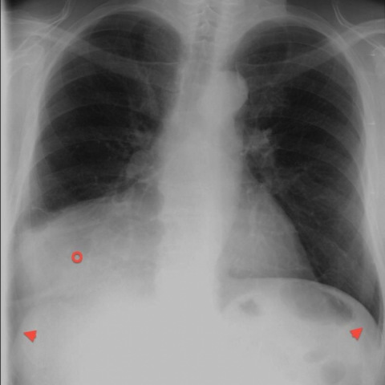

# 早期实验逐题档案：12266_8353800664461

独立评分参考选项：**B**。此页用于完成后的复盘，参考答案未反馈给历史推理过程。

[全部保留记录 JSON](12266_8353800664461.json) 包含逐轮终态、工具语义观察、检索记录与 V7 分支原文；每条带有来源文件。工具或模型的断言仍是待核实的观察。

## 原题与完整选项

Based on the posteroanterior chest radiograph (Figure 1), which of the following descriptions best characterizes the mass-like opacity in the right lower lung zone, and what is the most likely reason for the silhouette sign observed?

A) A round mass with sharp margins, predominantly soft tissue density, causing silhouette sign due to pleural effusion.
B) A well-defined mass with mixed density, silhouetting the right heart border and diaphragm due to its anterior mediastinal position.
C) A poorly defined opacity with irregular margins, predominantly air density, silhouetting the diaphragm due to lung consolidation.
D) A homogenous opacity with smooth margins, silhouetting the right heart border due to atelectasis of the right lower lobe.
E) A heterogeneous mass with sharp margins, predominantly fat density, silhouetting the right heart border due to its posterior mediastinal position.
F) An irregularly shaped mass with mixed density, silhouetting the diaphragm due to diaphragmatic hernia.

## 原图

来源输入：`data/validation_subset_v1.jsonl`；实际路径：`figures/12266/figure_1.jpg`。

## 当时保存的逐轮结果

备份/中断尝试单列，不能与最终完成版本相加。

| 来源 | 臂 | 选项 | 执行状态 | 参考匹配 |
|---|---|---|---|---|
| `credit_r3_drop1/results.jsonl` | agent | D | completed | 未答对 |
| `val29_full_r0/results.jsonl` | agent | 缺答 | case_budget_exceeded | 未答对 |
| `val29_full_r1/results.jsonl` | agent | D | completed | 未答对 |
| `val29_full_r2/results.jsonl` | agent | D | completed | 未答对 |
| `val29_full_r3/results.jsonl` | agent | D | completed | 未答对 |
| `val29_r1c_v1/results.jsonl` | agent | D | completed | 未答对 |
| `val29_r2_v1/results.jsonl` | agent | 缺答 | monetary_guard_error | 未答对 |
| `val29_r3_v1/results.jsonl` | agent | D | completed | 未答对 |
| `val30_r0_v1/results.jsonl` | agent | D | completed | 未答对 |
| `val30_r1_v1/results.jsonl` | agent | D | completed | 未答对 |
| `val30_r1b_v1/results.jsonl` | agent | D | completed | 未答对 |
| `val8_r0/results.jsonl` | agent | 缺答 | case_budget_exceeded | 未答对 |
| `val8_r1/results.jsonl` | agent | D | completed | 未答对 |
| `val8_r5/results.jsonl` | agent | D | completed | 未答对 |
| `val8_r57/results.jsonl` | agent | 缺答 | case_budget_exceeded | 未答对 |
| `val8b_r0/results.jsonl` | agent | D | completed | 未答对 |
| `val8b_r1/results.jsonl` | agent | D | completed | 未答对 |
| `val8b_r5/results.jsonl` | agent | D | completed | 未答对 |
| `val8b_r57/results.jsonl` | agent | D | completed | 未答对 |

保留的语义观察 0 条；检索记录 15 条；V7 恢复实验记录 0 条。详见同页 JSON。早期只有摘要/哈希的响应无法从哈希还原原文；此处未补写模型输出。
