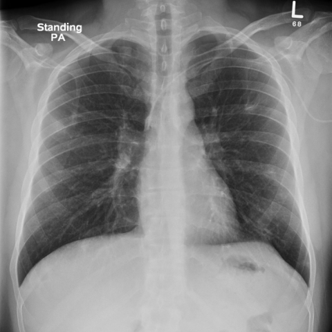

# 早期实验逐题档案：12721_8353800681884

独立评分参考选项：**B**。此页用于完成后的复盘，参考答案未反馈给历史推理过程。

[全部保留记录 JSON](12721_8353800681884.json) 包含逐轮终态、工具语义观察、检索记录与 V7 分支原文；每条带有来源文件。工具或模型的断言仍是待核实的观察。

## 原题与完整选项

Considering the chest X-ray findings and the patient's clinical presentation, which of the following best describes the progression and most likely diagnosis of the pulmonary condition seen in the X-rays?

A) The pulmonary nodules have increased in number and size, with new cavitations, suggesting a worsening case of tuberculosis.
B) The pulmonary nodules have decreased in size and number post-antibiotic therapy, with resolution of cavitations, consistent with septic emboli.
C) The thickened para-vertebral stripe has enlarged, indicating the progression of a metastatic disease.
D) The pulmonary nodules remain unchanged in number and size, indicating chronic inflammatory disease such as Wegner's granulomatosis.
E) There is complete resolution of all pulmonary nodules, suggesting an initial misdiagnosis.
F) The para-vertebral stripe thickening has resolved, indicating the treatment was effective against a primary spinal infection.

## 原图

来源输入：`v4_validation60/inputs.jsonl`；实际路径：`figures/12721/figure_1.jpg`。

来源输入：`v4_validation60/inputs.jsonl`；实际路径：`figures/12721/figure_7.jpg`。

同一固定 60 题后续证据：[V10/V11 图文档案](../../../v11/cases/12721_8353800681884.md)。不同轮 P0 独立生成，不能把差异直接视为方法收益。

## 当时保存的逐轮结果

备份/中断尝试单列，不能与最终完成版本相加。

| 来源 | 臂 | 选项 | 执行状态 | 参考匹配 |
|---|---|---|---|---|
| `v4_A_r1/results.jsonl` | agent | B | completed | 对 |
| `v4_B_r1/results.jsonl` | agent | B | completed | 对 |
| `v4_B_r1/results.jsonl.bak-before-resume` | agent | B | completed | 对 |
| `v4_C_r1/results.jsonl` | agent | 缺答 | case_budget_exceeded | 未答对 |
| `v7_recovery/round1.jsonl` | P0 | E | ok | 未答对 |
| `v7_recovery/round1.jsonl` | P1 | E | ok | 未答对 |
| `v7_recovery/round1.jsonl` | G1 | E | ok | 未答对 |
| `v7_recovery/round1.jsonl` | PB | E | ok | 未答对 |
| `v7_recovery/round1.jsonl` | GB | E | ok | 未答对 |
| `v7_recovery/round1.jsonl` | PC | E | ok | 未答对 |
| `v7_recovery/round1.jsonl` | GC | E | ok | 未答对 |
| `v7_recovery/round1_propose.jsonl` | P1 | 缺答 | p0_failed | 未答对 |
| `v7_recovery/round2_verify.jsonl` | P0 | B | ok | 对 |
| `v7_recovery/round2_verify.jsonl` | PB | B | ok | 对 |
| `v7_recovery/round2_verify.jsonl` | GB | B | ok | 对 |
| `v7_recovery/round2_verify.jsonl` | PC | B | ok | 对 |
| `v7_recovery/round2_verify.jsonl` | GC | B | ok | 对 |
| `v7_recovery/round2_verify.jsonl` | P1 | 缺答 | ok | 未答对 |

保留的语义观察 24 条；检索记录 2 条；V7 恢复实验记录 3 条。详见同页 JSON。早期只有摘要/哈希的响应无法从哈希还原原文；此处未补写模型输出。
