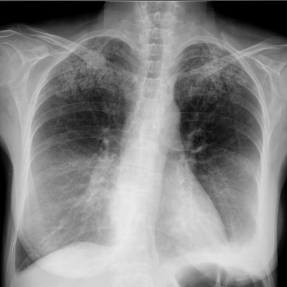

# 早期实验逐题档案：12811_8353800689121

独立评分参考选项：**A**。此页用于完成后的复盘，参考答案未反馈给历史推理过程。

[全部保留记录 JSON](12811_8353800689121.json) 包含逐轮终态、工具语义观察、检索记录与 V7 分支原文；每条带有来源文件。工具或模型的断言仍是待核实的观察。

## 原题与完整选项

Based on the chest X-ray findings, which of the following is the most likely diagnosis for the high-density micronodular opacities observed predominantly in the upper lobes of the lungs in Figure 1?

A) Diffuse pulmonary calcification due to end-stage renal insufficiency  
B) Miliary tuberculosis  
C) Silicosis  
D) Sarcoidosis  
E) Metastatic tumor  
F) Rheumatic mitral stenosis

## 原图

来源输入：`data/inference.jsonl`；实际路径：`cxr_034.png`。

来源输入：`data/memory_train_subset_v1.jsonl`；实际路径：`figures/12811/figure_1.jpg`。

## 当时保存的逐轮结果

备份/中断尝试单列，不能与最终完成版本相加。

| 来源 | 臂 | 选项 | 执行状态 | 参考匹配 |
|---|---|---|---|---|
| `diagnostic50_v1/results.jsonl` | agent | C | completed | 未答对 |
| `diagnostic50_v1/results.jsonl` | direct | C | completed | 未答对 |
| `train60_full_r0/results.jsonl` | agent | B | completed | 未答对 |
| `train60_r0_v2/results.jsonl` | agent | B | completed | 未答对 |
| `train60_r0_v3/results.jsonl` | agent | B | completed | 未答对 |

保留的语义观察 0 条；检索记录 0 条；V7 恢复实验记录 0 条。详见同页 JSON。早期只有摘要/哈希的响应无法从哈希还原原文；此处未补写模型输出。
