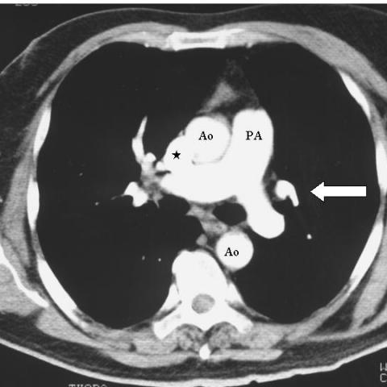
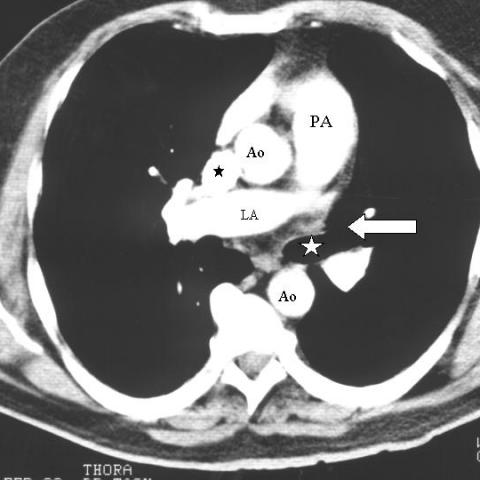

# 早期实验逐题档案：1281_8353802281357

独立评分参考选项：**B**。此页用于完成后的复盘，参考答案未反馈给历史推理过程。

[全部保留记录 JSON](1281_8353802281357.json) 包含逐轮终态、工具语义观察、检索记录与 V7 分支原文；每条带有来源文件。工具或模型的断言仍是待核实的观察。

## 原题与完整选项

Based on the chest X-ray findings, which of the following best describes the unusual vessel detected, its relation to the aortic arch, and the absence of the left upper pulmonary vein? Consider the position and branching pattern of the vessel in your reasoning.

A. The unusual vessel is positioned to the right of the aortic arch and drains directly into the superior vena cava, indicating a right-sided abnormality.
B. The unusual vessel is positioned to the left of the aortic arch and drains into the left brachiocephalic vein, consistent with a vertical vein.
C. The unusual vessel is positioned inferior to the aortic arch and shows no significant branching, suggesting an azygos vein.
D. The unusual vessel is positioned anterior to the aortic arch and drains into the right atrium, indicating a persistent left superior vena cava.
E. The unusual vessel does not demonstrate any branching and is situated posterior to the aortic arch, suggesting a normal anatomical variant.
F. The unusual vessel branches from the left upper pulmonary lobe directly into the left auricle, indicating an atrial septal defect.

## 原图

来源输入：`v4_validation60/inputs.jsonl`；实际路径：`figures/1281/figure_1b.jpg`。

来源输入：`v4_validation60/inputs.jsonl`；实际路径：`figures/1281/figure_1c.jpg`。

来源输入：`v4_validation60/inputs.jsonl`；实际路径：`figures/1281/figure_1d.jpg`。

同一固定 60 题后续证据：[V10/V11 图文档案](../../../v11/cases/1281_8353802281357.md)。不同轮 P0 独立生成，不能把差异直接视为方法收益。

## 当时保存的逐轮结果

备份/中断尝试单列，不能与最终完成版本相加。

| 来源 | 臂 | 选项 | 执行状态 | 参考匹配 |
|---|---|---|---|---|
| `v4_A_r1/results.jsonl` | agent | B | completed | 对 |
| `v4_B_r1/results.jsonl` | agent | B | completed | 对 |
| `v4_B_r1/results.jsonl.bak-before-resume` | agent | B | completed | 对 |
| `v4_C_r1/results.jsonl` | agent | B | completed | 对 |
| `v7_recovery/round1.jsonl` | P0 | B | ok | 对 |
| `v7_recovery/round1.jsonl` | P1 | B | ok | 对 |
| `v7_recovery/round1.jsonl` | G1 | B | ok | 对 |
| `v7_recovery/round1.jsonl` | PB | B | ok | 对 |
| `v7_recovery/round1.jsonl` | GB | B | ok | 对 |
| `v7_recovery/round1.jsonl` | PC | B | ok | 对 |
| `v7_recovery/round1.jsonl` | GC | B | ok | 对 |
| `v7_recovery/round1_propose.jsonl` | P0 | B | ok | 对 |
| `v7_recovery/round1_propose.jsonl` | P1 | B | ok | 对 |
| `v7_recovery/round1_propose.jsonl` | G1 | B | ok | 对 |
| `v7_recovery/round1_propose.jsonl` | PB | B | ok | 对 |
| `v7_recovery/round1_propose.jsonl` | GB | B | ok | 对 |
| `v7_recovery/round1_propose.jsonl` | PC | B | ok | 对 |
| `v7_recovery/round1_propose.jsonl` | GC | B | ok | 对 |
| `v7_recovery/round2_verify.jsonl` | P0 | B | ok | 对 |
| `v7_recovery/round2_verify.jsonl` | P1 | A | ok | 未答对 |
| `v7_recovery/round2_verify.jsonl` | G1 | B | ok | 对 |
| `v7_recovery/round2_verify.jsonl` | PB | B | ok | 对 |
| `v7_recovery/round2_verify.jsonl` | GB | B | ok | 对 |
| `v7_recovery/round2_verify.jsonl` | PC | B | ok | 对 |
| `v7_recovery/round2_verify.jsonl` | GC | B | ok | 对 |

保留的语义观察 8 条；检索记录 2 条；V7 恢复实验记录 3 条。详见同页 JSON。早期只有摘要/哈希的响应无法从哈希还原原文；此处未补写模型输出。
