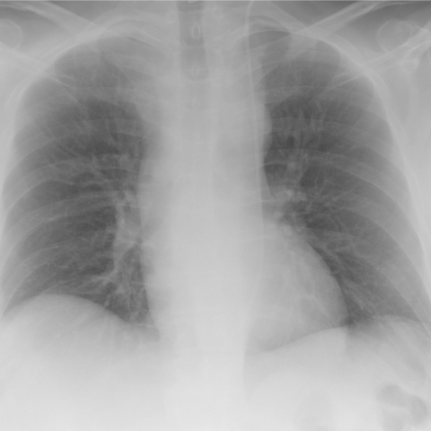

# 早期实验逐题档案：12893_8353800664398

独立评分参考选项：**D**。此页用于完成后的复盘，参考答案未反馈给历史推理过程。

[全部保留记录 JSON](12893_8353800664398.json) 包含逐轮终态、工具语义观察、检索记录与 V7 分支原文；每条带有来源文件。工具或模型的断言仍是待核实的观察。

## 原题与完整选项

Based on the chest X-ray findings in Figure 1, which of the following best describes the placement and path of the central venous catheter (CVC) and the most likely diagnosis?
A) The CVC is misplaced in the left internal mammary vein, indicated by a more anterior path in the mediastinum, suggesting a high risk of thoracic bleeding.
B) The CVC is correctly placed in the right superior vena cava, indicating normal placement without any vascular anomalies.
C) The CVC is misplaced in the pericardiophrenic vein, indicated by an anterior path in the middle mediastinum, suggesting a need for immediate repositioning.
D) The CVC path is consistent with a persistent left superior vena cava (PLSVC), running vertically in the left mediastinum and distally turning to the right, indicating a vascular anomaly but correct placement.
E) The CVC is in the azygos vein, indicated by a posterior path in the mediastinum, requiring further imaging to confirm misplacement.
F) The CVC is misplaced in the aorta, indicated by a lack of venous connection and immediate need for surgical intervention.

## 原图

来源输入：`data/inference.jsonl`；实际路径：`cxr_035.png`。

来源输入：`data/memory_train_subset_v1.jsonl`；实际路径：`figures/12893/figure_1.jpg`。

## 当时保存的逐轮结果

备份/中断尝试单列，不能与最终完成版本相加。

| 来源 | 臂 | 选项 | 执行状态 | 参考匹配 |
|---|---|---|---|---|
| `diagnostic50_v1/results.jsonl` | direct | D | completed | 对 |
| `diagnostic50_v1/results.jsonl` | agent | D | completed | 对 |
| `train60_full_r0/results.jsonl` | agent | D | completed | 对 |
| `train60_r0_v2/results.jsonl` | agent | D | completed | 对 |
| `train60_r0_v3/results.jsonl` | agent | D | completed | 对 |

保留的语义观察 0 条；检索记录 0 条；V7 恢复实验记录 0 条。详见同页 JSON。早期只有摘要/哈希的响应无法从哈希还原原文；此处未补写模型输出。
