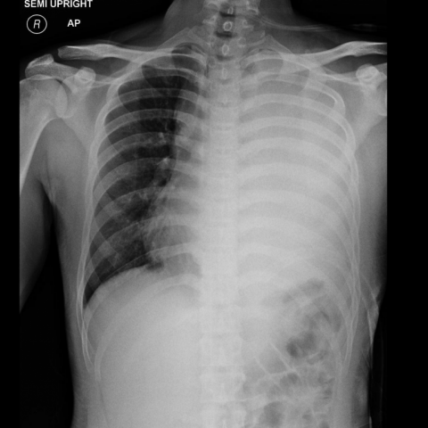

# 早期实验逐题档案：12895_8353800664503

独立评分参考选项：**B**。此页用于完成后的复盘，参考答案未反馈给历史推理过程。

[全部保留记录 JSON](12895_8353800664503.json) 包含逐轮终态、工具语义观察、检索记录与 V7 分支原文；每条带有来源文件。工具或模型的断言仍是待核实的观察。

## 原题与完整选项

Based on the chest X-ray findings in Figure 1, which of the following statements best describes the radiological presentation and supports the diagnosis of primary mediastinal large B-cell lymphoma in this case?  
A) Complete opacification of the left hemithorax with tracheal deviation to the left and heart displacement to the left, indicating left lung collapse due to pneumothorax.  
B) Complete opacification of the left hemithorax with tracheal deviation to the right and heart displacement to the right, suggesting a large pleural effusion or mass effect on the left side.  
C) Partial opacification of the left hemithorax with mediastinal structures centrally located, consistent with bilateral pulmonary edema.  
D) Complete opacification of the left hemithorax with no tracheal or mediastinal shift, indicating consolidated pneumonia.  
E) Complete opacification of the right hemithorax with tracheal deviation to the left and heart displacement to the left, indicative of right-sided pleural effusion.  
F) Complete opacification of the left hemithorax with tracheal deviation to the right and heart displacement to the left, indicative of right-sided tension pneumothorax.

## 原图

来源输入：`data/inference.jsonl`；实际路径：`cxr_036.png`。

来源输入：`data/memory_train_subset_v1.jsonl`；实际路径：`figures/12895/figure_1.jpg`。

## 当时保存的逐轮结果

备份/中断尝试单列，不能与最终完成版本相加。

| 来源 | 臂 | 选项 | 执行状态 | 参考匹配 |
|---|---|---|---|---|
| `diagnostic50_v1/results.jsonl` | agent | B | completed | 对 |
| `diagnostic50_v1/results.jsonl` | direct | B | completed | 对 |
| `train60_full_r0/results.jsonl` | agent | B | completed | 对 |
| `train60_r0_v2/results.jsonl` | agent | B | completed | 对 |
| `train60_r0_v3/results.jsonl` | agent | B | completed | 对 |

保留的语义观察 0 条；检索记录 0 条；V7 恢复实验记录 0 条。详见同页 JSON。早期只有摘要/哈希的响应无法从哈希还原原文；此处未补写模型输出。
